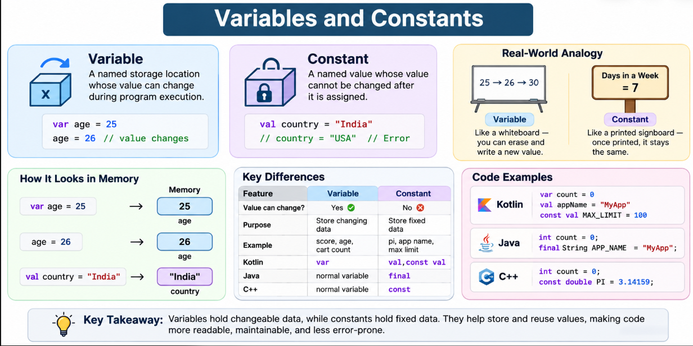

# Variables and Constants



## 1. What are Variables and Constants?

A **variable** is a named storage location in memory whose value can change during program execution.

A **constant** is a named value whose value cannot be changed after it is assigned.

In simple words:

- **Variable** → value can change
- **Constant** → value stays fixed

These are among the most fundamental building blocks in programming.

---

## 2. Why do we need them?

Programs need a way to store data temporarily or permanently while running.

For example:

- storing a user's name
- storing a login status
- storing the number of items in a cart
- storing a fixed tax rate
- storing the value of π

Without variables and constants, we would have no practical way to hold and reuse data in code.

---

## 3. What problem do they solve?

Variables and constants solve the problem of **data storage and reuse**.

Instead of writing raw values again and again, we store them with meaningful names.

### Without variables
```kotlin
println("Rohit")
println("Rohit")
println("Rohit")