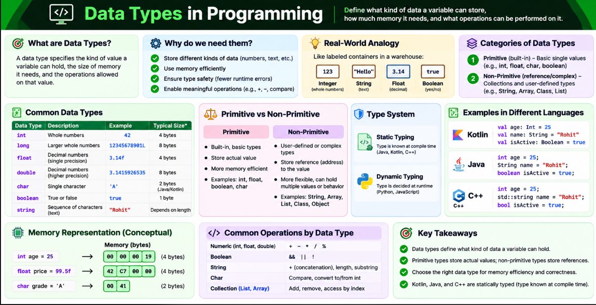

# Data Types



## 1. What is a Data Type?

A data type defines the kind of value a variable can hold,
the operations that can be performed on it, and how that
value is represented by the programming language.

For example, a variable can store:

- A whole number
- A decimal number
- A character
- A sequence of characters
- A true or false value
- A collection of values
- An object

```kotlin
val age: Int = 28
val temperature: Double = 36.5
val grade: Char = 'A'
val name: String = "Alex"
val isLoggedIn: Boolean = true
```

Each variable has a data type that determines what kind
of data it can represent.

---

## 2. Why do we need Data Types?

Data types help programming languages determine:

- What kind of value a variable can store.
- What operations are valid on that value.
- How the value should be represented in memory.
- What range of values can be represented.
- Whether an operation is type-safe.
- How values should be interpreted.

For example:

```kotlin
val a = 10
val b = 20

println(a + b) // 30
```

Now consider:

```kotlin
val a = "10"
val b = "20"

println(a + b) // 1020
```

The same `+` operator produces different results
depending on the data types of its operands.

---

## 3. Real-World Analogy

Think of data types as different types of containers.

| Container | Data Type |
|---|---|
| Box containing whole numbers | Integer |
| Measuring cup | Floating-point |
| Single letter tile | Character |
| Notebook containing text | String |
| ON/OFF switch | Boolean |
| Organizer with multiple compartments | Array |
| Folder containing related information | Object |

Each container is designed to hold a particular kind
of information.

Similarly, a data type defines what kind of information
a variable represents.

---

## 4. Classification of Data Types

Data types can broadly be categorized as:

    Data Types
    |
    |-- Basic / Primitive Types
    |   |-- Integer
    |   |-- Floating-point
    |   |-- Character
    |   |-- Boolean
    |
    |-- Composite / Structured Types
    |   |-- String
    |   |-- Array
    |   |-- List
    |   |-- Map
    |   |-- Tuple
    |
    |-- User-Defined Types
    |   |-- Class
    |   |-- Structure
    |   |-- Enumeration
    |
    |-- Special Types
        |-- Void / Unit
        |-- Null-related types
        |-- Nothing / Never

The exact classification depends on the programming
language. For example, Kotlin treats its basic types
as objects at the language level, although the compiler
can represent many of them using JVM primitives.

---

## 5. Integer Data Types

Integer types represent whole numbers without
fractional components.

Examples:

```text
10
-25
0
100000
```

### Kotlin Integer Types

| Type | Size | Range |
|---|---|---|
| Byte | 8 bits | -128 to 127 |
| Short | 16 bits | -32,768 to 32,767 |
| Int | 32 bits | -2^31 to 2^31 - 1 |
| Long | 64 bits | -2^63 to 2^63 - 1 |

```kotlin
val smallNumber: Byte = 100
val shortNumber: Short = 30000
val age: Int = 28
val population: Long = 8000000000L
```

### Java

```java
byte smallNumber = 100;
short shortNumber = 30000;
int age = 28;
long population = 8000000000L;
```

### C++

```cpp
#include <cstdint>

std::int8_t smallNumber = 100;
std::int16_t shortNumber = 30000;
std::int32_t age = 28;
std::int64_t population = 8000000000LL;
```

In C++, the sizes of standard types such as `int`
and `long` can vary between platforms.

Fixed-width integer types from `<cstdint>` provide
specific widths when supported by the implementation.

---

## 6. Signed vs Unsigned Integers

A signed integer can represent negative numbers,
zero and positive numbers.

An unsigned integer represents zero and positive
numbers only.

For an 8-bit integer:

| Type | Minimum | Maximum |
|---|---|---|
| Signed | -128 | 127 |
| Unsigned | 0 | 255 |

Both types use 8 bits, but they interpret the
available bit patterns differently.

### Kotlin

```kotlin
val signed: Int = -100
val unsigned: UInt = 100u
```

### C++

```cpp
int signedNumber = -100;
unsigned int unsignedNumber = 100;
```

Use unsigned types when their arithmetic and
representation suit the problem, not simply because
a value is expected to be positive.

Unsigned arithmetic can introduce unexpected
wraparound behavior.

---

## 7. Floating-Point Data Types

Floating-point types represent real numbers
approximately, including fractional values.

Examples:

```text
3.14159
25.75
-0.001
```

| Type | Typical Size | Approximate Precision |
|---|---|---|
| Float | 32 bits | 6-7 significant digits |
| Double | 64 bits | 15-17 significant digits |

### Kotlin

```kotlin
val temperature: Float = 36.5f
val pi: Double = 3.141592653589793
```

### Java

```java
float temperature = 36.5f;
double pi = 3.141592653589793;
```

### C++

```cpp
float temperature = 36.5f;
double pi = 3.141592653589793;
```

These sizes apply to Kotlin/JVM and Java and are
common, but not universally guaranteed, in C++.

### Important: Floating-Point Precision

```kotlin
println(0.1 + 0.2)
```

Output:

```text
0.30000000000000004
```

This happens because many decimal fractions cannot
be represented exactly using binary floating-point.

For financial calculations, consider decimal
arithmetic such as BigDecimal or integer values
representing the smallest currency unit.

---

## 8. Character Data Type

A character type represents a character or
a code unit, depending on the language.

### Kotlin

```kotlin
val grade: Char = 'A'
val digit: Char = '7'
val symbol: Char = '@'
```

### Java

```java
char grade = 'A';
```

### C++

```cpp
char grade = 'A';
```

Kotlin/JVM and Java use a 16-bit UTF-16 code unit
for Char and char.

A single Unicode character may require more than
one UTF-16 code unit.

C++ char occupies one byte, which is typically
8 bits.

### Character vs String

```kotlin
val character: Char = 'A'
val text: String = "A"
```

These are different data types, even though their
displayed values look similar.

---

## 9. Boolean Data Type

A Boolean represents one of two logical values:

- true
- false

Booleans are commonly used in conditions,
validation and application state management.

### Kotlin

```kotlin
val isLoggedIn: Boolean = true
val isAdmin: Boolean = false

if (isLoggedIn) {
    println("Welcome!")
}
```

### Java

```java
boolean isLoggedIn = true;
```

### C++

```cpp
bool isLoggedIn = true;
```

Although a Boolean requires only two logical
states, its actual memory usage depends on the
language, runtime and storage context.

It does not necessarily occupy only one bit.

---

## 10. String Data Type

A String represents a sequence of text characters
or code units.

### Kotlin

```kotlin
val name: String = "Alex"
val message: String = "Hello World"
```

### Java

```java
String name = "Alex";
```

### C++

```cpp
#include <string>

std::string name = "Alex";
```

Common string operations include:

- Concatenation
- Searching
- Substring extraction
- Comparison
- Replacement
- Splitting

```kotlin
val name = "Alex"

println(name.length)
println(name.uppercase())
println(name.lowercase())
```

Strings are immutable in Kotlin and Java.

C++ std::string objects are mutable.

---

## 11. Arrays and Collections

Arrays and collections allow us to store
multiple values in a structured way.

### Array

```kotlin
val numbers = intArrayOf(10, 20, 30, 40)

println(numbers[0]) // 10
```

### List

```kotlin
val names = listOf("Alex", "John", "Sam")
```

### Set

```kotlin
val uniqueNumbers = setOf(1, 2, 2, 3)

println(uniqueNumbers) // [1, 2, 3]
```

### Map

```kotlin
val scores = mapOf(
    "Alex" to 90,
    "John" to 85
)

println(scores["Alex"]) // 90
```

| Type | Purpose |
|---|---|
| Array | Indexed, fixed-length collection |
| List | Ordered collection |
| Set | Collection of unique elements |
| Map | Key-value associations |

Arrays and collections will be covered
individually in the Data Structures section.

---

## 12. User-Defined Data Types

Programming languages allow developers to create
their own types to represent real-world entities
and application-specific concepts.

### Class in Kotlin

```kotlin
data class User(
    val name: String,
    val age: Int,
    val isActive: Boolean
)

val user = User("Alex", 28, true)
```

### Class in Java

```java
class User {
    String name;
    int age;
    boolean isActive;
}
```

### Structure in C++

```cpp
#include <string>

struct User {
    std::string name;
    int age;
    bool isActive;
};
```

Here, User is a custom data type that combines
multiple related values into a single entity.

### Enumeration

An enum represents a predefined set of
named values.

```kotlin
enum class LoginStatus {
    LOADING,
    SUCCESS,
    FAILURE
}

val status = LoginStatus.SUCCESS
```

Enums are useful when a value should belong to
a known, limited set of alternatives.

---

## 13. Special Data Types

### Void / Unit

These represent the absence of a meaningful
return value from a function.

Kotlin:

```kotlin
fun greet(): Unit {
    println("Hello")
}
```

Java:

```java
void greet() {
    System.out.println("Hello");
}
```

C++:

```cpp
void greet() {
    std::cout << "Hello";
}
```

Kotlin Unit is an actual type with a single value.

Java and C++ void indicate that a function does
not return a value.

### Nullable Types

Kotlin allows developers to explicitly specify
whether a type can contain null.

```kotlin
val name: String = "Alex"

val optionalName: String? = null
```

String cannot normally contain null.

String? can contain either a String or null.

### Nothing

Kotlin's Nothing represents a type that has
no possible values.

A function returning Nothing never returns
normally.

```kotlin
fun fail(message: String): Nothing {
    throw IllegalStateException(message)
}
```

This is commonly used for functions that
always throw exceptions or never terminate.

---

## 14. How Data Types Work in Memory

Computers represent information using bits.

A bit can have one of two values:

```text
0 or 1
```

A byte contains 8 bits.

For example, the decimal number 10 can be
represented in binary as:

```text
00001010
```

A 32-bit integer representation of 10:

```text
00000000 00000000 00000000 00001010
```

The data type determines how these bit patterns
are interpreted.

Consider this 8-bit pattern:

```text
11111111
```

It can represent:

- 255 as an unsigned 8-bit integer.
- -1 as a signed 8-bit two's complement integer.

The underlying bits are identical.

The interpretation is different.

Data type information helps compilers and runtimes
interpret values and perform appropriate operations.

Actual storage may involve additional overhead,
object headers, references, alignment or compiler
optimizations.

---

## 15. Integer Overflow and Underflow

Every fixed-width integer type has a limited range.

Overflow occurs when a mathematical result exceeds
the maximum representable value.

Underflow, in this integer context, occurs when a
result falls below the minimum representable value.

### Kotlin/JVM Example

```kotlin
var number = Int.MAX_VALUE

println(number) // 2147483647

number++

println(number) // -2147483648
```

The result wraps around to the minimum Int value.

### Important Language Differences

- Kotlin/JVM and Java Int arithmetic wraps around.
- C++ unsigned integer arithmetic wraps around.
- C++ signed integer overflow has undefined behavior.
- Python integers can grow beyond fixed-width limits,
  subject to available memory.

Never assume that overflow behaves identically
across programming languages.

---

## 16. Type Inference

Type inference allows the compiler to determine
a variable's type from its assigned value.

### Explicit Type

```kotlin
val age: Int = 28
```

### Inferred Type

```kotlin
val age = 28
```

Both variables have the Int type.

Other examples:

```kotlin
val name = "Alex"     // String
val price = 99.99    // Double
val isActive = true  // Boolean
```

### Java

```java
var name = "Alex";
```

### C++

```cpp
auto age = 28;
```

Type inference does not make a statically typed
language dynamically typed.

The compiler still determines and enforces
the variable's type.

---

## 17. Type Safety

Type safety helps prevent invalid operations
involving incompatible data types.

```kotlin
var age: Int = 28

age = "Twenty Eight" // Compilation error
```

The compiler prevents a String from being assigned
to an Int variable.

Another example:

```kotlin
fun calculateSquare(number: Int): Int {
    return number * number
}

calculateSquare(5)      // Valid
calculateSquare("Five") // Compilation error
```

Type safety helps detect programming mistakes
before or during execution, depending on
the language's type system.

---

## 18. Primitive Types vs Reference Types

This distinction is particularly relevant
to Java and JVM-based programming.

A Java primitive variable directly represents
a primitive value.

A reference variable holds a reference to an
object, or null.

```java
int age = 28;

User user = new User();
```

Conceptual representation:

    Primitive variable:

    age
    +------+
    |  28  |
    +------+


    Reference variable:

    user
    +-----------+
    | Reference | ----------> User Object
    +-----------+             +-------------+
                              | name        |
                              | age         |
                              | isActive    |
                              +-------------+

This is a conceptual model, not a guarantee
of physical memory placement.

Kotlin/JVM can use primitive representations
for basic types and boxed representations
when necessary.

Reference types, boxing, value semantics
and memory allocation will be discussed
in separate chapters.

---

## 19. Real-World Android Development Examples

### User Information

```kotlin
data class User(
    val id: Long,
    val name: String,
    val age: Int,
    val isVerified: Boolean,
    val email: String?
)
```

### Vehicle Information

```kotlin
data class Vehicle(
    val vin: String,
    val speed: Float,
    val batteryPercentage: Int,
    val latitude: Double,
    val longitude: Double,
    val isEngineRunning: Boolean
)
```

### Application State

```kotlin
enum class NetworkStatus {
    CONNECTED,
    DISCONNECTED,
    CONNECTING
}
```

### API Configuration

```kotlin
const val MAX_RETRY_COUNT: Int = 3
const val TIMEOUT_MS: Long = 30000L
const val BASE_URL: String = "https://api.example.com"
```

Selecting appropriate data types makes application
models clearer and reduces invalid states.

---

## 20. Choosing the Right Data Type

| Use Case | Recommended Kotlin Type |
|---|---|
| User age | Int |
| Database numeric ID | Long |
| Phone number | String |
| Postal code | String |
| GPS coordinates | Double |
| Sensor readings | Float or Double |
| Login status | Boolean |
| User name | String |
| Product price | BigDecimal or minor-unit Long |
| List of users | List<User> |
| Network status | Enum |
| Optional email | String? |
| Epoch timestamp in milliseconds | Long |
| Vehicle identification number | String |

A phone number is not necessarily a numeric type
just because it contains digits.

Phone numbers may contain leading zeros,
country codes and formatting characters.

We generally do not perform arithmetic on them.

Choose a type according to the meaning of the
data, not just its appearance.

---

## 21. Common Mistakes

### Mistake 1: Using Int for excessively large values

```kotlin
val population: Int = 8000000000 // Error
```

Correct:

```kotlin
val population: Long = 8000000000L
```

### Mistake 2: Using Double for exact financial calculations

```kotlin
val price = 0.1 + 0.2
```

Better on Kotlin/JVM:

```kotlin
import java.math.BigDecimal

val price = BigDecimal("0.1")
    .add(BigDecimal("0.2"))

println(price) // 0.3
```

### Mistake 3: Storing phone numbers as integers

Bad:

```kotlin
val phoneNumber = 9876543210L
```

Better:

```kotlin
val phoneNumber = "+91 9876543210"
```

### Mistake 4: Comparing floating-point values directly

```kotlin
println(0.1 + 0.2 == 0.3) // false
```

For suitable numerical calculations, use an
appropriate tolerance:

```kotlin
import kotlin.math.abs

val result = 0.1 + 0.2

println(abs(result - 0.3) < 0.000001)
```

The appropriate tolerance depends on the
scale and requirements of the calculation.

### Mistake 5: Representing multiple states using Booleans

Bad:

```kotlin
var isLoading = false
var isSuccess = false
var isError = false
```

This allows contradictory states.

Better:

```kotlin
enum class UiStatus {
    IDLE,
    LOADING,
    SUCCESS,
    ERROR
}

var status = UiStatus.IDLE
```

---

## 22. Advantages of Data Types

- Improve code readability.
- Help prevent invalid operations.
- Communicate the meaning of data.
- Enable compiler optimizations.
- Improve application reliability.
- Support abstraction and structured data modeling.
- Help detect programming errors.

## 23. Limitations and Trade-offs

- Fixed-width numeric types have limited ranges.
- Floating-point numbers introduce rounding errors.
- Incorrect type selection can waste memory.
- Type conversions may result in data loss.
- Boxing can introduce additional overhead.
- Strict type systems may require explicit conversions.

---

## 24. Best Practices

- Choose types based on the meaning of the data.
- Use Int for ordinary integer calculations.
- Use Long when larger integer ranges are required.
- Use decimal arithmetic for exact financial values.
- Use Boolean for genuinely binary states.
- Use enums for finite sets of states.
- Use custom classes to model related information.
- Avoid unnecessary nullable types.
- Be aware of overflow and precision limitations.
- Prefer meaningful types over generic Any or Object
  when a more specific type is appropriate.

---

## 25. Interview Questions and Answers

### Q1. What is a data type?

A data type defines the values a variable can
represent, the permitted operations and how those
values are interpreted.

### Q2. What is the difference between Float and Double?

Float generally uses 32-bit floating-point
representation, while Double uses 64-bit
representation and provides greater precision.

### Q3. What is integer overflow?

Integer overflow occurs when an arithmetic result
exceeds the representable range of an integer type.

### Q4. What is the difference between Char and String?

Char represents a character or code unit,
depending on the language. String represents
a sequence of text elements.

### Q5. Why should phone numbers be stored as Strings?

Because they are identifiers rather than
quantities and may contain leading zeros,
country codes and formatting characters.

### Q6. What is type inference?

Type inference is the process through which
a compiler determines a type without requiring
an explicit type declaration.

### Q7. Why does 0.1 + 0.2 not equal 0.3 exactly?

Because many decimal fractions cannot be
represented exactly in binary floating-point.

### Q8. What is the difference between signed and unsigned?

Signed integers support negative and positive
values, whereas unsigned integers represent
non-negative values.

### Q9. What is a user-defined data type?

A type created by a programmer to represent
application-specific data or behavior.

Examples include classes, structures and enums.

### Q10. Does a Boolean occupy one bit in memory?

Not necessarily. A Boolean has two logical values,
but its physical memory representation depends
on the language and implementation.

### Q11. Is Kotlin dynamically typed because it supports
type inference?

No. Kotlin is statically typed. The compiler
infers and checks types at compile time.

### Q12. What is the difference between Unit and Nothing?

Unit represents a type with one value and is
commonly used when a function returns no
meaningful result.

Nothing has no possible values and represents
computations that never return normally.

---

## 26. Practice Exercises

1. Create variables representing a student's
   name, age, grade and attendance status.

2. Find the minimum and maximum values of
   Byte, Short, Int and Long in Kotlin.

3. Demonstrate integer overflow using Int.MAX_VALUE.

4. Compare the precision of Float and Double.

5. Create a Vehicle data class containing five
   properties of different data types.

6. Create an enum representing the states of
   an API request.

7. Explain why a credit card number should
   be represented as a String.

8. Experiment with the expression 0.1 + 0.2
   using Double and BigDecimal.

---

## 27. Key Takeaways

- Data types determine how values are represented
  and what operations are permitted.
- Different numeric types have different ranges
  and precision.
- The same bit pattern can represent different
  values depending on its interpretation.
- Floating-point arithmetic is not always exact.
- Custom types help represent real-world entities.
- Type inference is not dynamic typing.
- Choosing the correct data type is an important
  software design decision.

---

## 28. Related Concepts

- Variables and Constants
- Mutability and Immutability
- Static vs Dynamic Typing
- Strong vs Weak Typing
- Type Casting and Type Conversion
- Value Types vs Reference Types
- Stack vs Heap Memory
- Boxing and Unboxing
- Generics and Templates
- Null Safety