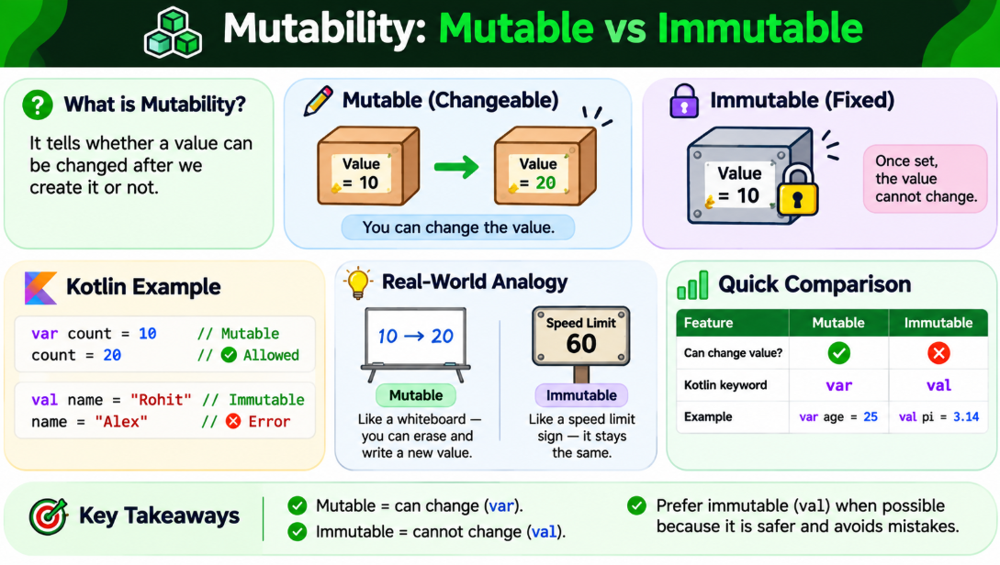

# Mutable vs Immutable



## 1. What is Mutability?

Mutability describes whether an object or value
can be changed after it is created.

- **Mutable:** Can be changed.
- **Immutable:** Cannot be changed.

## 2. Real-World Analogy

Imagine two notebooks:

- **Mutable:** A notebook written with a pencil.
  You can erase and rewrite its contents.
- **Immutable:** A printed book.
  To change its contents, you need a new copy.

## 3. Mutable vs Immutable in Kotlin

### Mutable List

```kotlin
val numbers = mutableListOf(1, 2, 3)

numbers.add(4)

println(numbers) // [1, 2, 3, 4]
```

The contents of the original list have changed.

### Immutable String

```kotlin
val name = "Hello"
val newName = name + " World"

println(name)    // Hello
println(newName) // Hello World
```

The original string remains unchanged.
A new string is produced instead.

## 4. Does `val` Mean Immutable?

No! This is a common misunderstanding in Kotlin.

```kotlin
val numbers = mutableListOf(1, 2, 3)

numbers.add(4) // Allowed

numbers = mutableListOf(5, 6) // Error
```

`val` prevents reassignment, but the object
it refers to can still be mutable.

Think of it as owning a fixed locker.
You cannot switch lockers, but you can
change what is inside your locker.

## 5. Mutable vs Immutable in Java

```java
// Mutable object
StringBuilder text = new StringBuilder("Hello");
text.append(" World");

// Immutable object
String name = "Hello";
String newName = name + " World";
```

StringBuilder changes the existing object.
String operations produce a new value.

## 6. Mutable vs Immutable in C++

```cpp
// Mutable
int age = 25;
age = 26;

// Constant value
const int maxAge = 100;
maxAge = 200; // Error
```

## 7. Key Differences

| Mutable | Immutable |
|---|---|
| Contents can change | Contents cannot change |
| Can modify existing objects | Changes require a new value |
| Useful for changing state | Useful for predictable state |
| Requires care when shared | Generally safer to share |

## 8. Real-World Android Example

```kotlin
data class User(
    val name: String,
    val age: Int
)

val user = User("Alex", 25)

val updatedUser = user.copy(age = 26)
```

Output:

```text
user        = User(Alex, 25)
updatedUser = User(Alex, 26)
```

Instead of modifying the original user,
we create an updated copy.

This approach is commonly used in Android
UI state management, MVVM and Jetpack Compose.

## 9. Why Prefer Immutability?

- Prevents accidental modifications.
- Makes code easier to debug.
- Makes application state more predictable.
- Reduces problems when sharing data across threads.

However, mutable objects are useful when
frequent updates are necessary.

## 10. Interview Questions

**Q: What is mutability?**

The ability to change an object's contents
after it has been created.

**Q: Are Kotlin Strings immutable?**

Yes.

**Q: Does `val` guarantee object immutability?**

No. It prevents reassignment, not necessarily
modification of the referenced object.

**Q: Is Kotlin List always immutable?**

No. Kotlin List provides a read-only interface,
but the underlying collection may still be mutable.

## 11. Key Takeaways

- Mutable means changeable.
- Immutable means unchangeable.
- Reassignment and object mutation are different.
- Prefer immutability when mutation is unnecessary.