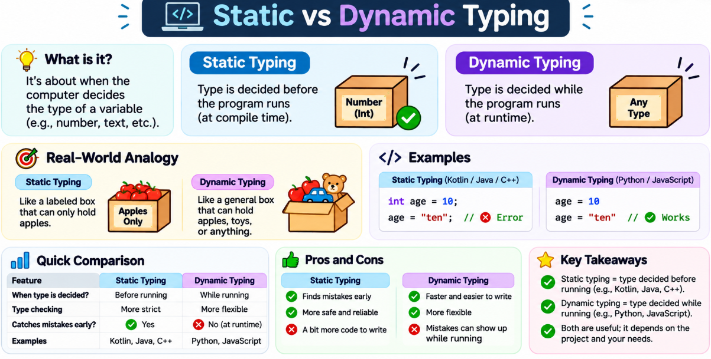

# Static vs Dynamic Typing



## 1. What is Static vs Dynamic Typing?

Programming languages differ in when they check
the types of values and variables.

- **Static Typing:** Types are checked before
  the program runs (compile time).
- **Dynamic Typing:** Types are checked as
  the program runs (runtime).

## 2. Real-World Analogy

Imagine two school bags:

### Static Typing

A bag specifically designed to hold books.

You cannot put a football inside it because
the rules specify what it can hold.

### Dynamic Typing

A general-purpose bag.

You can put a book inside it, remove the book,
and put a football inside instead.

## 3. Static Typing

In statically typed languages, a variable's
type is established before execution.

### Kotlin

```kotlin
var age: Int = 25

age = 30      // Allowed
age = "Hello" // Compilation error
```

### Java

```java
int age = 25;

age = 30;      // Allowed
age = "Hello"; // Compilation error
```

### C++

```cpp
int age = 25;

age = 30;      // Allowed
age = "Hello"; // Compilation error
```

The compiler detects incompatible assignments
before the program runs.

## 4. Dynamic Typing

In dynamically typed languages, a variable
can refer to values of different types over time.

### Python

```python
value = 25
value = "Hello"
value = True

print(value) # True
```

### JavaScript

```javascript
let value = 25;
value = "Hello";
value = true;

console.log(value); // true
```

The variable can refer to an integer, a string
or a boolean without a fixed declared type.

## 5. Compile Time vs Runtime

Consider this Kotlin code:

```kotlin
val result = "Hello" - 5
```

The compiler rejects the code before execution.

Now consider Python:

```python
result = "Hello" - 5
```

Python raises a TypeError when this line executes.

The main difference is when the type error
is detected.

## 6. Type Inference

Look at this Kotlin code:

```kotlin
var age = 25
```

We did not explicitly mention Int, but the
compiler automatically understands that age
has the Int type.

```kotlin
age = "Hello" // Compilation error
```

This is called Type Inference.

Type inference does NOT mean dynamic typing.

## 7. Key Differences

| Static Typing | Dynamic Typing |
|---|---|
| Types checked at compile time | Types checked at runtime |
| Incompatible assignments rejected early | Variables can refer to different types |
| Easier to catch type errors early | Greater flexibility |
| Helpful for large codebases | Useful for rapid prototyping |
| Kotlin, Java, C++, Rust, Go | Python, JavaScript, Ruby |

## 8. Advantages and Disadvantages

### Static Typing

Advantages:
- Catches many errors before execution.
- Better IDE suggestions and refactoring.
- Makes large codebases easier to maintain.

Disadvantages:
- Sometimes requires more explicit declarations.
- Less flexibility when changing variable types.

### Dynamic Typing

Advantages:
- Flexible and concise code.
- Useful for scripting and rapid development.

Disadvantages:
- Type errors may appear during execution.
- Requires careful testing.

## 9. Real-World Android Example

```kotlin
fun calculateSpeed(distance: Double, time: Double): Double {
    return distance / time
}

calculateSpeed(100.0, 2.0) // Allowed
calculateSpeed("100", 2.0) // Compilation error
```

Kotlin prevents us from accidentally passing
a string where a number is expected.

This helps catch bugs before releasing
an Android application.

## 10. Interview Questions

**Q: What is static typing?**

Checking types before program execution.

**Q: What is dynamic typing?**

Checking types during program execution.

**Q: Is Kotlin statically or dynamically typed?**

Statically typed.

**Q: Is Python dynamically typed?**

Yes.

**Q: Does type inference mean dynamic typing?**

No. The compiler still determines and checks
the type before execution.

## 11. Key Takeaways

- Static typing checks types before execution.
- Dynamic typing checks types during execution.
- Dynamically typed values still have types.
- Type inference is not dynamic typing.
- Neither approach eliminates all runtime errors.