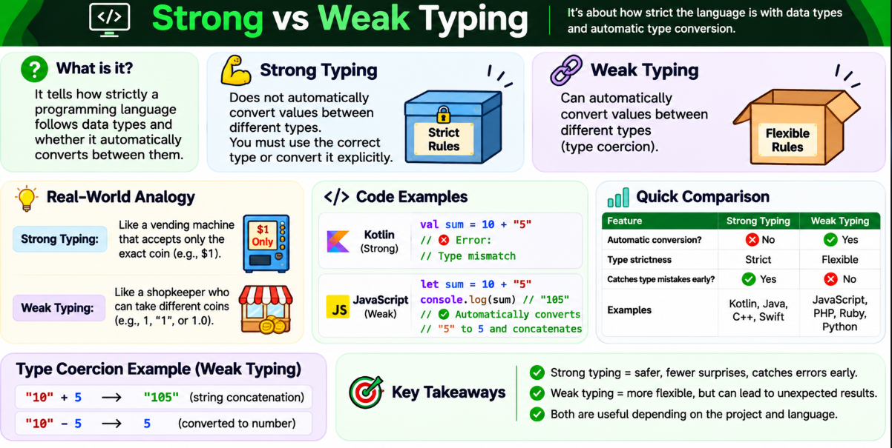

# Strong vs Weak Typing



## 1. What is Strong vs Weak Typing?

Strong and weak typing describe how strictly a
programming language handles different data types.

- **Strong Typing:** Generally prevents incompatible
  types from being mixed without conversion.
- **Weak Typing:** More readily converts values
  between different types automatically.

There is no universal definition of strong and
weak typing. These terms describe general behavior.

## 2. Real-World Analogy

Imagine buying a chocolate bar using money.

### Strong Typing

A shopkeeper accepts only money.
You cannot pay using an apple.

You must first exchange the apple for money.

### Weak Typing

A shopkeeper automatically exchanges your apple
for money and completes the purchase.

This automatic conversion is called Type Coercion.

## 3. Strong Typing

### Kotlin

```kotlin
val number = 10
val text = "20"

val result = number + text // Error
```

You must explicitly convert the string into a number.

```kotlin
val result = number + text.toInt()

println(result) // 30
```

### Python

```python
number = 10
text = "20"

result = number + text # TypeError
```

Correct approach:

```python
result = number + int(text)

print(result) # 30
```

## 4. Weak Typing

### JavaScript

```javascript
let number = 10;
let text = "20";

console.log(number + text); // "1020"
```

JavaScript automatically converts the number
into a string and joins the two strings.

Another example:

```javascript
console.log("20" - 10); // 10
```

Here, JavaScript automatically converts the
string into a number.

This flexibility can sometimes produce
unexpected results.

## 5. Key Differences

| Strong Typing | Weak Typing |
|---|---|
| Stricter type handling | More flexible type handling |
| Often requires explicit conversion | Allows more implicit conversions |
| Helps avoid unexpected conversions | Can produce unexpected results |
| Examples: Kotlin, Python | Example: JavaScript |

## 6. Static vs Dynamic vs Strong vs Weak

These are two different concepts.

- Static vs Dynamic: WHEN are types checked?
- Strong vs Weak: HOW strictly are types handled?

| Language | Static/Dynamic | Strong/Weak (Common Classification) |
|---|---|---|
| Kotlin | Static | Strong |
| Java | Static | Strong |
| Python | Dynamic | Strong |
| JavaScript | Dynamic | Weak |
| C++ | Static | Mixed / Context-dependent |

Python is dynamically typed but strongly typed.

Therefore, dynamic typing does not automatically
mean weak typing.

## 7. Advantages and Disadvantages

### Strong Typing

- Prevents many unexpected type conversions.
- Makes code behavior more predictable.
- May require additional conversion code.

### Weak Typing

- Offers flexible operations.
- Requires fewer explicit conversions.
- Can introduce unexpected behavior and bugs.

## 8. Real-World Android Example

Imagine receiving a battery percentage as a
String from an API.

```kotlin
val batteryPercentage = "85"

val battery = batteryPercentage.toIntOrNull()

if (battery != null && battery < 20) {
    println("Low Battery")
}
```

Kotlin requires us to convert the string before
performing a numeric comparison.

Using toIntOrNull() also helps us handle
invalid input safely.

## 9. Interview Questions

**Q: What is strong typing?**

Strict handling of data types that generally
prevents incompatible operations.

**Q: What is weak typing?**

Flexible type handling that allows more
automatic type conversions.

**Q: What is type coercion?**

Automatic conversion of a value from one
data type to another.

**Q: Can a dynamically typed language be strongly typed?**

Yes. Python is a common example.

## 10. Key Takeaways

- Strong typing = stricter type handling.
- Weak typing = more flexible type conversion.
- Type coercion means automatic type conversion.
- Strong typing is not the same as static typing.
- Prefer explicit conversions when clarity matters.