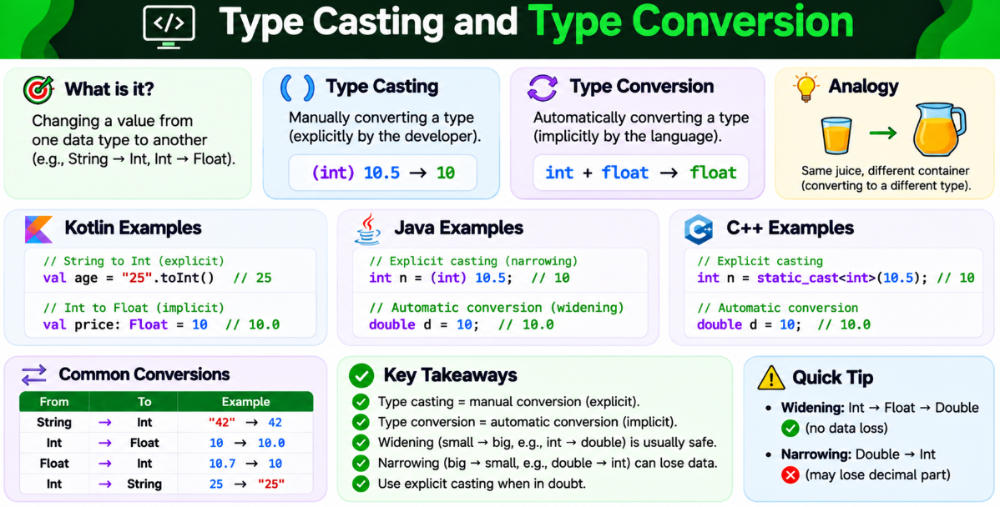

# Type Casting and Type Conversion



## 1. What is Type Conversion?

Type conversion means changing a value from one
data type to another.

For example:

- Integer → Double
- String → Integer
- Integer → String

Think of exchanging dollars for rupees.
The representation changes, but the meaning
is preserved as much as possible.

## 2. Implicit Conversion (Automatic)

The programming language automatically converts
one data type into another when allowed.

### Java / C++

```java
int number = 10;
double result = number;

// Result: 10.0
```

No manual conversion is required.

## 3. Explicit Conversion (Manual)

The programmer explicitly requests a conversion.

### Kotlin

```kotlin
val number = 10
val decimal = number.toDouble() // 10.0
val text = number.toString()    // "10"
val age = "25".toInt()          // 25
```

### Java

```java
double price = 99.99;
int result = (int) price;

// Result: 99
```

### C++

```cpp
double price = 99.99;
int result = static_cast<int>(price);

// Result: 99
```

## 4. Widening vs Narrowing Conversion

| Widening | Narrowing |
|---|---|
| Smaller to larger numeric range | Larger to smaller numeric range |
| Int to Long | Long to Int |
| Generally safer | May lose data |

Example:

```kotlin
val a = 10
val b = a.toLong() // 10

val c = 10.99
val d = c.toInt()  // 10
```

Notice how the decimal part is lost.

## 5. Type Casting in Kotlin

Casting can also tell the compiler to treat
an existing object as another compatible type.

```kotlin
val value: Any = "Hello"

val text = value as String
```

### Unsafe Cast (`as`)

```kotlin
val value: Any = 100
val text = value as String // Exception
```

### Safe Cast (`as?`)

```kotlin
val value: Any = 100
val text = value as? String // null
```

Casting an Int to a String does not convert
the number into text. Use toString() instead.

## 6. Real-World Android Example

A user enters their age into an EditText.
The input is received as a String.

```kotlin
val input = "28"
val age = input.toIntOrNull()
```

If the input is invalid, toIntOrNull()
returns null instead of throwing an exception.

## 7. Key Takeaways

- Conversion changes a value's data type.
- Implicit conversion happens automatically.
- Explicit conversion is requested manually.
- Narrowing conversion may lose data.
- Object casting checks type compatibility.
- Kotlin's safe cast (as?) returns null if it fails.