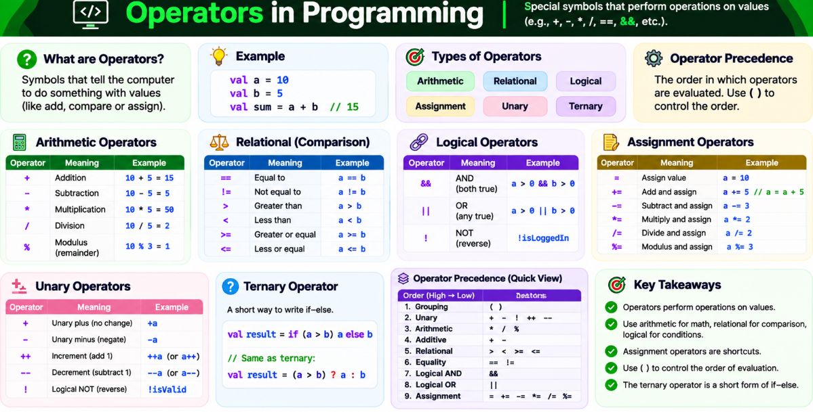

# Operators in Programming



## 1. What is an Operator?

An operator is a symbol or keyword that tells
the computer to perform an operation.

```kotlin
val result = 10 + 5
```

- `10` and `5` are operands.
- `+` is the operator.
- `15` is the result.

Think of operators as buttons on a calculator.

## 2. Types of Operators

Operators can be classified into the following categories:

- Arithmetic Operators
- Comparison (Relational) Operators
- Logical Operators
- Assignment Operators
- Increment and Decrement Operators
- Unary Operators
- Bitwise Operators
- Bit Shift Operators
- Ternary Operators
- Null Safety Operators
- Type Checking Operators
- Identity Operators
- Range Operators
- Membership Operators
- Pointer Operators

---

## 3. Arithmetic Operators

Used to perform mathematical calculations.

| Operator | Meaning | Example | Result |
|---|---|---|---|
| `+` | Addition | 10 + 3 | 13 |
| `-` | Subtraction | 10 - 3 | 7 |
| `*` | Multiplication | 10 * 3 | 30 |
| `/` | Division | 10 / 3 | 3 |
| `%` | Remainder | 10 % 3 | 1 |

### Kotlin Example

```kotlin
val a = 10
val b = 3

println(a + b) // 13
println(a - b) // 7
println(a * b) // 30
println(a / b) // 3
println(a % b) // 1
```

### Integer vs Decimal Division

```kotlin
println(10 / 3)     // 3
println(10.0 / 3)   // 3.3333333333333335
```

When dividing two integers, the fractional
part is discarded in Kotlin, Java and C++.

### Remainder Operator (%)

The remainder operator returns what is left
after division.

```text
10 / 3 = 3, remainder 1

10 % 3 = 1
```

Example: Checking whether a number is even.

```kotlin
val number = 8

println(number % 2 == 0) // true
```

---

## 4. Comparison Operators

Comparison operators compare two values and
return either true or false.

| Operator | Meaning | Example | Result |
|---|---|---|---|
| `==` | Equal to | 10 == 10 | true |
| `!=` | Not equal to | 10 != 5 | true |
| `>` | Greater than | 10 > 5 | true |
| `<` | Less than | 10 < 5 | false |
| `>=` | Greater than or equal | 10 >= 10 | true |
| `<=` | Less than or equal | 10 <= 5 | false |

```kotlin
val a = 10
val b = 5

println(a == b) // false
println(a != b) // true
println(a > b)  // true
println(a < b)  // false
println(a >= b) // true
println(a <= b) // false
```

### Real-World Example

```kotlin
val age = 20

val canVote = age >= 18

println(canVote) // true
```

---

## 5. Logical Operators

Logical operators combine or reverse Boolean
conditions.

| Operator | Meaning |
|---|---|
| `&&` | Logical AND |
| `\|\|` | Logical OR |
| `!` | Logical NOT |

### 5.1 Logical AND (&&)

Returns true only when BOTH conditions are true.

Imagine entering a building that requires
both an ID card and a password.

| A | B | A AND B |
|---|---|---|
| true | true | true |
| true | false | false |
| false | true | false |
| false | false | false |

```kotlin
val hasIdCard = true
val hasPassword = false

println(hasIdCard && hasPassword) // false
```

Both requirements must be satisfied.

### 5.2 Logical OR (||)

Returns true when AT LEAST ONE condition is true.

Imagine entering a building using either
a password or a fingerprint.

| A | B | A OR B |
|---|---|---|
| true | true | true |
| true | false | true |
| false | true | true |
| false | false | false |

```kotlin
val hasPassword = false
val hasFingerprint = true

println(hasPassword || hasFingerprint) // true
```

Only one requirement needs to be satisfied.

### 5.3 Logical NOT (!)

Reverses a Boolean value.

- true becomes false.
- false becomes true.

| A | NOT A |
|---|---|
| true | false |
| false | true |

```kotlin
val isLoggedIn = true

println(!isLoggedIn) // false
```

Another example:

```kotlin
val isBlocked = false

if (!isBlocked) {
    println("Access granted")
}
```

Read `!isBlocked` as "is NOT blocked".

The same operation works in Java and C++.

```cpp
bool isBlocked = false;

if (!isBlocked) {
    cout << "Access granted";
}
```

### 5.4 Logical XOR (Exclusive OR)

Returns true when exactly ONE of two
conditions is true.

If both are true, the result is false.

| A | B | A XOR B |
|---|---|---|
| true | true | false |
| true | false | true |
| false | true | true |
| false | false | false |

```kotlin
println(true xor true)   // false
println(true xor false)  // true
println(false xor true)  // true
println(false xor false) // false
```

### 5.5 Short-Circuit Evaluation

Logical AND and OR may skip checking
the second condition.

```kotlin
false && checkPassword()
```

checkPassword() is not called because
the first condition is already false.

```kotlin
true || checkPassword()
```

checkPassword() is not called because
the first condition is already true.

This is called short-circuit evaluation.

---

## 6. Assignment Operators

Assignment operators assign or update values.

| Operator | Example | Equivalent |
|---|---|---|
| `=` | x = 10 | Assign 10 |
| `+=` | x += 5 | x = x + 5 |
| `-=` | x -= 5 | x = x - 5 |
| `*=` | x *= 5 | x = x * 5 |
| `/=` | x /= 5 | x = x / 5 |
| `%=` | x %= 5 | x = x % 5 |

```kotlin
var x = 10

x += 5 // 15
x -= 5 // 10
x *= 2 // 20
x /= 4 // 5
x %= 2 // 1
```

### Assignment vs Comparison

```kotlin
x = 10  // Assign a value
x == 10 // Compare values
```

Do not confuse `=` with `==`.

---

## 7. Increment and Decrement Operators

### Increment (++)

Increases a numeric variable by one.

```kotlin
var count = 10
count++

println(count) // 11
```

### Decrement (--)

Decreases a numeric variable by one.

```kotlin
var count = 10
count--

println(count) // 9
```

### Prefix Increment (++x)

Update first, then return the new value.

```kotlin
var x = 5
val result = ++x

println(result) // 6
println(x)      // 6
```

### Postfix Increment (x++)

Return the old value, then update.

```kotlin
var x = 5
val result = x++

println(result) // 5
println(x)      // 6
```

### Prefix Decrement (--x)

```kotlin
var x = 5
val result = --x

println(result) // 4
println(x)      // 4
```

### Postfix Decrement (x--)

```kotlin
var x = 5
val result = x--

println(result) // 5
println(x)      // 4
```

---

## 8. Unary, Binary and Ternary Operators

These names describe how many operands
an operator works with.

| Type | Operands | Example |
|---|---|---|
| Unary | One | !flag |
| Binary | Two | a + b |
| Ternary | Three | condition ? a : b |

### Unary Operators

```kotlin
val a = -10     // Unary minus
val b = +10     // Unary plus
val c = !true   // Logical NOT
```

### Binary Operators

```kotlin
val a = 10 + 5
val b = 10 > 5
val c = true && false
```

Each operation requires two operands.

Note: A binary operator is not necessarily
a bitwise operator.

The word binary here means two operands,
not binary numbers.

---

## 9. Understanding Binary Numbers

Before learning bitwise operators, we need
to understand binary numbers.

Computers represent data using bits.

A bit can be either:

- 0 (OFF)
- 1 (ON)

Decimal uses ten digits (0-9).

Binary uses two digits (0 and 1).

### Decimal to Binary

| Decimal | Binary |
|---|---|
| 0 | 0000 |
| 1 | 0001 |
| 2 | 0010 |
| 3 | 0011 |
| 4 | 0100 |
| 5 | 0101 |
| 6 | 0110 |
| 7 | 0111 |
| 8 | 1000 |
| 9 | 1001 |
| 10 | 1010 |

Each binary position has a value.

```text
Position:   8   4   2   1
Binary:     0   1   0   1

Value = 0 + 4 + 0 + 1
      = 5
```

Another example:

```text
Position:   8   4   2   1
Binary:     1   0   1   0

Value = 8 + 0 + 2 + 0
      = 10
```

---

## 10. Bitwise Operators

Bitwise operators perform operations on
individual bits of integer values.

Unlike logical operators, which work with
Boolean conditions, bitwise operators work
with binary representations of numbers.

| Java / C++ | Kotlin | Meaning |
|---|---|---|
| `&` | `and` | Bitwise AND |
| `\|` | `or` | Bitwise OR |
| `^` | `xor` | Bitwise XOR |
| `~` | `inv()` | Bitwise NOT |
| `<<` | `shl` | Left Shift |
| `>>` | `shr` | Right Shift |
| `>>>` (Java) | `ushr` | Unsigned Right Shift |

For the following examples:

```text
A = 5 = 0101
B = 3 = 0011
```

The four-bit diagrams are simplified
for easier understanding.

### 10.1 Bitwise AND (&)

A result bit becomes 1 only when both
input bits are 1.

| A | B | A AND B |
|---|---|---|
| 0 | 0 | 0 |
| 0 | 1 | 0 |
| 1 | 0 | 0 |
| 1 | 1 | 1 |

```text
    0101  (5)
  & 0011  (3)
  ------
    0001  (1)
```

Kotlin:

```kotlin
println(5 and 3) // 1
```

Java / C++:

```cpp
int result = 5 & 3; // 1
```

Real-world use: Checking whether a specific
permission or flag is enabled.

### 10.2 Bitwise OR (|)

A result bit becomes 1 when either
input bit is 1.

| A | B | A OR B |
|---|---|---|
| 0 | 0 | 0 |
| 0 | 1 | 1 |
| 1 | 0 | 1 |
| 1 | 1 | 1 |

```text
    0101  (5)
  | 0011  (3)
  ------
    0111  (7)
```

Kotlin:

```kotlin
println(5 or 3) // 7
```

Java / C++:

```cpp
int result = 5 | 3; // 7
```

Real-world use: Combining multiple flags
or permissions.

### 10.3 Bitwise XOR (^)

A result bit becomes 1 when the two
input bits are different.

| A | B | A XOR B |
|---|---|---|
| 0 | 0 | 0 |
| 0 | 1 | 1 |
| 1 | 0 | 1 |
| 1 | 1 | 0 |

```text
    0101  (5)
  ^ 0011  (3)
  ------
    0110  (6)
```

Kotlin:

```kotlin
println(5 xor 3) // 6
```

Java / C++:

```cpp
int result = 5 ^ 3; // 6
```

Real-world use: Toggling bits and detecting
differences between bit patterns.

Interesting property:

```kotlin
println(5 xor 5) // 0
println(5 xor 0) // 5
```

### 10.4 Bitwise NOT (~)

Reverses every bit.

- 0 becomes 1.
- 1 becomes 0.

| A | NOT A |
|---|---|
| 0 | 1 |
| 1 | 0 |

Simplified four-bit example:

```text
Original: 0101
Inverted: 1010
```

However, Kotlin Int uses 32 bits.

```text
 5 = 00000000 00000000 00000000 00000101

-6 = 11111111 11111111 11111111 11111010
```

Kotlin:

```kotlin
println(5.inv()) // -6
```

Java / C++ (two's complement int):

```cpp
int result = ~5; // -6
```

For signed two's complement integers:

```text
~x = -x - 1

~5 = -5 - 1 = -6
```

Do not confuse logical NOT (!) with
bitwise NOT (~).

```kotlin
println(!true)   // false
println(5.inv()) // -6
```

---

## 11. Bit Shift Operators

Bit shift operators move bits to the left
or right.

### 11.1 Left Shift (<<)

Moves bits to the left and fills empty
positions on the right with zeros.

```text
5       = 00000101

5 << 1  = 00001010 = 10

5 << 2  = 00010100 = 20
```

Kotlin:

```kotlin
println(5 shl 1) // 10
println(5 shl 2) // 20
```

Java / C++:

```cpp
int a = 5 << 1; // 10
int b = 5 << 2; // 20
```

Left shifting a positive number by one
is equivalent to multiplying it by two,
provided the result fits in the integer type.

### 11.2 Signed Right Shift (>>)

Moves bits to the right.

An arithmetic right shift preserves
the sign bit.

```text
20      = 00010100

20 >> 1 = 00001010 = 10

20 >> 2 = 00000101 = 5
```

Kotlin:

```kotlin
println(20 shr 1) // 10
println(20 shr 2) // 5
```

Java / C++:

```cpp
int a = 20 >> 1; // 10
int b = 20 >> 2; // 5
```

For non-negative integers, shifting right
by one is equivalent to integer division
by two.

### 11.3 Unsigned Right Shift (>>>)

Moves bits to the right and fills empty
positions on the left with zeros, regardless
of the original sign.

Consider a 32-bit signed integer:

```text
-8:

11111111 11111111 11111111 11111000

Signed right shift by 1:

11111111 11111111 11111111 11111100

Result: -4

Unsigned right shift by 1:

01111111 11111111 11111111 11111100

Result: 2147483644
```

Kotlin:

```kotlin
println(-8 shr 1)  // -4
println(-8 ushr 1) // 2147483644
```

Java:

```java
System.out.println(-8 >> 1);  // -4
System.out.println(-8 >>> 1); // 2147483644
```

C++ does not have a >>> operator.

Right shifting an unsigned integer
provides zero-fill behavior.

---

## 12. Logical vs Bitwise Operators

| Logical | Bitwise |
|---|---|
| Works with Boolean conditions | Works with individual bits |
| Returns a Boolean | Returns a numeric bit pattern |
| AND: && | AND: & |
| OR: \|\| | OR: \| |
| NOT: ! | NOT: ~ |
| XOR: Boolean xor | XOR: ^ |

```kotlin
// Logical operations
println(true && false) // false
println(true || false) // true
println(!true)         // false

// Bitwise operations
println(5 and 3) // 1
println(5 or 3)  // 7
println(5 xor 3) // 6
println(5.inv()) // -6
```

Java and C++ also support certain
bitwise-style operators on Boolean operands.

Unlike && and ||, those operations
do not short-circuit.

---

## 13. Real-World Bitwise Example: Permissions

Imagine an application with three permissions.

```kotlin
val READ = 1    // 0001
val WRITE = 2   // 0010
val DELETE = 4  // 0100
```

### Combining Permissions (OR)

```kotlin
var permissions = READ or WRITE

println(permissions) // 3
```

```text
0001  READ
0010  WRITE
----
0011  READ + WRITE
```

### Checking a Permission (AND)

```kotlin
val canRead = (permissions and READ) != 0

println(canRead) // true
```

### Adding a Permission (OR)

```kotlin
permissions = permissions or DELETE

println(permissions) // 7
```

### Removing a Permission (AND + NOT)

```kotlin
permissions = permissions and WRITE.inv()

println(permissions) // 5
```

### Toggling a Permission (XOR)

```kotlin
permissions = permissions xor DELETE

println(permissions) // 1
```

This technique is called bitmasking.

Android also uses bit flags in areas such
as Intent flags and window configuration.

---

## 14. Ternary Operator (?:)

The ternary operator is a shorter way
to write simple if-else expressions.

Syntax:

```text
condition ? valueIfTrue : valueIfFalse
```

Java:

```java
int age = 20;

String status = age >= 18 ? "Adult" : "Minor";
```

C++:

```cpp
int age = 20;

std::string status = age >= 18 ? "Adult" : "Minor";
```

Kotlin does not have a ternary operator.

Instead, if-else can return a value.

```kotlin
val age = 20

val status = if (age >= 18) "Adult" else "Minor"
```

---

## 15. Kotlin Null Safety Operators

### 15.1 Safe Call Operator (?.)

Accesses a property or calls a method only
when the object is not null.

```kotlin
val name: String? = null

println(name?.length) // null
```

### 15.2 Elvis Operator (?:)

Provides a default value when the expression
on the left is null.

```kotlin
val name: String? = null

val displayName = name ?: "Guest"

println(displayName) // Guest
```

Think of it as:

"If there is no value, use this instead."

### 15.3 Non-Null Assertion Operator (!!)

Tells the compiler that a value must
not be null.

```kotlin
val name: String? = "Alex"

println(name!!.length) // 4
```

But if the value is null:

```kotlin
val name: String? = null

println(name!!.length) // NullPointerException
```

Use !! carefully because it can crash
your application.

---

## 16. Type Checking and Casting Operators

### is Operator

Checks whether an object has a particular type.

```kotlin
val value: Any = "Hello"

println(value is String) // true
println(value is Int)    // false
```

### !is Operator

Checks whether an object is NOT of a type.

```kotlin
val value: Any = "Hello"

println(value !is Int) // true
```

### as Operator

Casts an object to a compatible type.

```kotlin
val value: Any = "Hello"

val text = value as String
```

### as? Operator

Returns null when casting fails.

```kotlin
val value: Any = 100

val text = value as? String

println(text) // null
```

Java uses instanceof for type checking.

```java
Object value = "Hello";

System.out.println(value instanceof String); // true
```

---

## 17. Equality vs Identity Operators

Kotlin provides two different kinds of equality.

| Operator | Meaning |
|---|---|
| `==` | Structural equality |
| `!=` | Structural inequality |
| `===` | Referential equality |
| `!==` | Referential inequality |

Structural equality checks whether the
objects are considered equal in value.

Referential equality checks whether both
references point to the same object.

```kotlin
data class User(val name: String)

val user1 = User("Alex")
val user2 = User("Alex")
val user3 = user1

println(user1 == user2)  // true
println(user1 === user2) // false
println(user1 === user3) // true

println(user1 != user2)  // false
println(user1 !== user2) // true
```

Think of two identical mobile phones.

They may have the same specifications,
but they are still two separate objects.

Note: In Java, == compares object references,
while equals() can compare object contents.

---

## 18. Range Operators

Range operators represent a sequence of
values between two boundaries.

### Inclusive Range (..)

```kotlin
for (i in 1..5) {
    println(i)
}

// 1 2 3 4 5
```

### Exclusive Upper Boundary (..<)

```kotlin
for (i in 1..<5) {
    println(i)
}

// 1 2 3 4
```

### Reverse Range (downTo)

```kotlin
for (i in 5 downTo 1) {
    println(i)
}

// 5 4 3 2 1
```

### Step

```kotlin
for (i in 1..10 step 2) {
    println(i)
}

// 1 3 5 7 9
```

downTo and step are Kotlin infix functions.

---

## 19. Membership Operators

Check whether a value belongs to a range
or collection.

### in Operator

```kotlin
val numbers = listOf(1, 2, 3, 4, 5)

println(3 in numbers) // true
```

### !in Operator

```kotlin
println(10 !in numbers) // true
```

Real-world example:

```kotlin
val age = 25

if (age in 18..60) {
    println("Eligible")
}
```

---

## 20. Pointer Operators in C++

These operators are especially important
when working with pointers and linked lists.

### 20.1 Address-of Operator (&)

Returns the memory address of a variable.

```cpp
int number = 10;

int* ptr = &number;
```

Think of a memory address as the house
address of a variable.

### 20.2 Dereference Operator (*)

Accesses the value stored at the address
held by a pointer.

```cpp
int number = 10;
int* ptr = &number;

cout << *ptr; // 10
```

You can also change the original value:

```cpp
*ptr = 20;

cout << number; // 20
```

Conceptual diagram:

```text
ptr                     number
+------------+          +------+
| Address    | -------> |  20  |
+------------+          +------+
```

### 20.3 Member Access Operator (.)

Accesses a member of an object directly.

```cpp
struct Node {
    int data;
};

Node node{10};

cout << node.data; // 10
```

### 20.4 Arrow Operator (->)

Accesses a member through a pointer
to an object.

```cpp
Node node{10};

Node* ptr = &node;

cout << ptr->data; // 10
```

These two expressions are equivalent
for an ordinary object pointer:

```cpp
ptr->data

(*ptr).data
```

The arrow operator first accesses the
object through the pointer and then
accesses its member.

### 20.5 Scope Resolution Operator (::)

Accesses names within a namespace or class.

```cpp
std::cout << "Hello";
```

Here, cout belongs to the std namespace.

Kotlin uses :: for callable references,
which is a different purpose.

---

## 21. Other Common Operators

### Indexing Operator ([])

Accesses an element using its index.

```kotlin
val numbers = intArrayOf(10, 20, 30)

println(numbers[0]) // 10

numbers[0] = 50

println(numbers[0]) // 50
```

### String Concatenation (+)

Joins strings together.

```kotlin
val text = "Hello" + " World"

println(text) // Hello World
```

### Sizeof Operator (C++)

Returns the size of a type or object
in bytes.

```cpp
cout << sizeof(char); // 1
cout << sizeof(int);  // Commonly 4
```

The size of int depends on the platform.

### Exponentiation Operator (**)

Supported in languages such as Python
and JavaScript.

```python
print(2 ** 3) # 8
```

Kotlin uses pow() instead.

```kotlin
import kotlin.math.pow

println(2.0.pow(3)) // 8.0
```

Remember that ^ means XOR in Java,
C++ and Python, not exponentiation.

---

## 22. Operator Precedence

Operator precedence determines how
operations are grouped in an expression.

```kotlin
val result = 10 + 5 * 2

println(result) // 20
```

Multiplication has higher precedence
than addition.

```kotlin
val result = (10 + 5) * 2

println(result) // 30
```

Parentheses change the grouping.

Common precedence order, from higher
to lower, for many C-style expressions:

| Priority | Operators |
|---|---|
| 1 | Grouping () |
| 2 | Unary !, -, + |
| 3 | Multiplication *, /, % |
| 4 | Addition +, - |
| 5 | Comparison <, >, <=, >= |
| 6 | Equality ==, != |
| 7 | Logical AND && |
| 8 | Logical OR \|\| |

This is a simplified table.

Exact precedence rules vary by language.

When in doubt, use parentheses.

---

## 23. Operator Associativity

Associativity determines how operators
with the same precedence are grouped.

### Left Associativity

```kotlin
val result = 10 - 5 - 2
```

Evaluated as:

```text
(10 - 5) - 2 = 3
```

### Right Associativity

Java and C++ assignment operators
group from right to left.

```java
int a, b, c;

a = b = c = 10;
```

Equivalent to:

```java
c = 10;
b = c;
a = b;
```

Kotlin does not support chained assignment
in this form.

Associativity describes grouping, not
necessarily the order in which every
operand is evaluated.

---

## 24. Quick Revision Cheat Sheet

| Operator | Purpose | Example |
|---|---|---|
| `+` | Addition | 5 + 3 = 8 |
| `-` | Subtraction | 5 - 3 = 2 |
| `*` | Multiplication | 5 * 3 = 15 |
| `/` | Division | 10 / 2 = 5 |
| `%` | Remainder | 10 % 3 = 1 |
| `==` | Equality | 5 == 5 |
| `!=` | Inequality | 5 != 3 |
| `>` | Greater than | 5 > 3 |
| `<` | Less than | 3 < 5 |
| `>=` | Greater or equal | 5 >= 5 |
| `<=` | Less or equal | 3 <= 5 |
| `&&` | Logical AND | true && false |
| `\|\|` | Logical OR | true OR false |
| `!` | Logical NOT | !true |
| `&` | Bitwise AND | 5 & 3 = 1 |
| `\|` | Bitwise OR | 5 OR 3 = 7 |
| `^` | Bitwise XOR | 5 ^ 3 = 6 |
| `~` | Bitwise NOT | ~5 = -6 |
| `<<` | Left shift | 5 << 1 = 10 |
| `>>` | Right shift | 20 >> 1 = 10 |
| `>>>` | Zero-fill right shift | Java |
| `++` | Increment | x++ |
| `--` | Decrement | x-- |
| `?:` | Elvis in Kotlin | name ?: "Guest" |
| `?.` | Safe call in Kotlin | user?.name |
| `!!` | Non-null assertion | user!!.name |
| `===` | Reference equality in Kotlin | a === b |
| `is` | Type checking in Kotlin | x is String |
| `as` | Type casting in Kotlin | x as String |
| `as?` | Safe casting in Kotlin | x as? String |
| `..` | Inclusive range in Kotlin | 1..5 |
| `in` | Membership in Kotlin | x in 1..5 |
| `->` | Pointer member access in C++ | ptr->data |
| `::` | Scope resolution in C++ | std::cout |
| `[]` | Indexing | array[0] |

Operator syntax and behavior depend on
the programming language.

---

## 25. Key Takeaways

- Operators tell the computer what operation
  to perform.
- Logical operators work with conditions.
- Bitwise operators manipulate individual bits.
- Logical NOT reverses true and false.
- Bitwise NOT reverses individual bits.
- XOR returns 1 when two bits are different.
- Shift operators move bits left or right.
- Unary operators work with one operand.
- Binary operators work with two operands.
- Ternary operators work with three operands.
- Precedence and associativity determine grouping.
- Use parentheses when expressions are confusing.