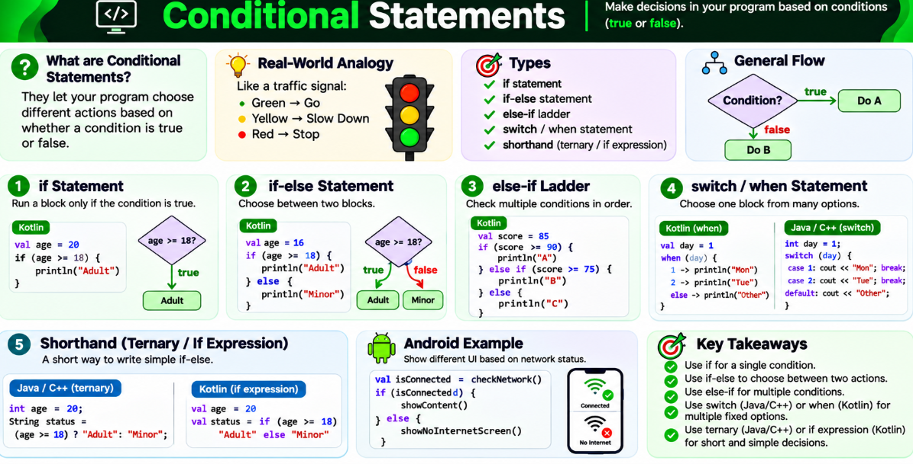

# Conditional Statements



## 1. What are Conditional Statements?

Conditional statements allow a program to make
decisions based on whether a condition is true or false.

Think of making a decision before going outside:

- If it is raining, take an umbrella.
- Otherwise, wear sunglasses.

Programming works in the same way.

## 2. Types of Conditional Statements

- if
- if-else
- if-else-if
- Nested if
- switch / when
- Ternary operator

---

## 3. If Statement

Executes a block of code only when
the condition is true.

```kotlin
val age = 20

if (age >= 18) {
    println("You can vote")
}
```

Output:

```text
You can vote
```

If the condition is false, the block is skipped.

---

## 4. If-Else Statement

Executes one block when the condition is true
and another block when it is false.

```kotlin
val age = 15

if (age >= 18) {
    println("Adult")
} else {
    println("Minor")
}
```

Output:

```text
Minor
```

---

## 5. If-Else-If Statement

Used when there are multiple conditions
to check.

```kotlin
val marks = 75

if (marks >= 90) {
    println("Grade A")
} else if (marks >= 70) {
    println("Grade B")
} else if (marks >= 50) {
    println("Grade C")
} else {
    println("Fail")
}
```

Output:

```text
Grade B
```

Conditions are checked from top to bottom.
Only the first matching block is executed.

---

## 6. Nested If Statement

An if statement inside another if statement.

```kotlin
val age = 25
val hasDrivingLicense = true

if (age >= 18) {
    if (hasDrivingLicense) {
        println("You can drive")
    } else {
        println("Get a driving license")
    }
} else {
    println("You are too young to drive")
}
```

Think of it as passing through two security
checkpoints. You must pass the first checkpoint
before reaching the second.

---

## 7. Switch Statement (Java and C++)

Used to choose between multiple cases.

### Java

```java
int day = 2;

switch (day) {
    case 1:
        System.out.println("Monday");
        break;

    case 2:
        System.out.println("Tuesday");
        break;

    case 3:
        System.out.println("Wednesday");
        break;

    default:
        System.out.println("Invalid day");
}
```

Output:

```text
Tuesday
```

- case: A possible matching value.
- break: Exits the switch statement.
- default: Executes if no case matches.

Without break, traditional switch statements
can continue into subsequent cases.
This is called fall-through.

---

## 8. When Expression (Kotlin)

Kotlin uses when as an alternative to switch.

```kotlin
val day = 2

when (day) {
    1 -> println("Monday")
    2 -> println("Tuesday")
    3 -> println("Wednesday")
    else -> println("Invalid day")
}
```

Output:

```text
Tuesday
```

Unlike traditional switch statements,
Kotlin's when does not fall through
and does not require break.

### When with Ranges

```kotlin
val marks = 85

when (marks) {
    in 90..100 -> println("Grade A")
    in 70..89 -> println("Grade B")
    in 50..69 -> println("Grade C")
    in 0..49 -> println("Fail")
    else -> println("Invalid marks")
}
```

### When Without an Argument

```kotlin
val temperature = 38

when {
    temperature > 35 -> println("Hot")
    temperature > 20 -> println("Warm")
    else -> println("Cold")
}
```

---

## 9. Conditional Statements vs Expressions

A statement performs an action.
An expression produces a value.

In Kotlin, if and when can produce values.

### If as an Expression

```kotlin
val age = 20

val status = if (age >= 18) "Adult" else "Minor"

println(status) // Adult
```

### When as an Expression

```kotlin
val code = 200

val status = when (code) {
    200 -> "Success"
    404 -> "Not Found"
    500 -> "Server Error"
    else -> "Unknown"
}

println(status) // Success
```

---

## 10. Ternary Operator (Java and C++)

A shorter way to write simple if-else decisions.

Syntax:

```text
condition ? valueIfTrue : valueIfFalse
```

### Java

```java
int age = 20;

String status = age >= 18 ? "Adult" : "Minor";
```

### C++

```cpp
int age = 20;

std::string status = age >= 18 ? "Adult" : "Minor";
```

### Kotlin Equivalent

```kotlin
val status = if (age >= 18) "Adult" else "Minor"
```

Kotlin does not have a ternary operator.

---

## 11. Combining Multiple Conditions

### AND (&&)

Both conditions must be true.

```kotlin
if (age >= 18 && hasDrivingLicense) {
    println("You can drive")
}
```

### OR (||)

At least one condition must be true.

```kotlin
if (hasPassword || hasFingerprint) {
    println("Login successful")
}
```

### NOT (!)

Reverses a Boolean condition.

```kotlin
val isConnected = false

if (!isConnected) {
    println("No internet connection")
}
```

---

## 12. Real-World Android Example

Displaying battery status:

```kotlin
val batteryPercentage = 15

val status = when {
    batteryPercentage <= 10 -> "Critical Battery"
    batteryPercentage <= 20 -> "Low Battery"
    batteryPercentage < 100 -> "Normal"
    else -> "Fully Charged"
}

println(status) // Low Battery
```

Conditional statements are commonly used for:

- Login validation
- API response handling
- Permission checks
- UI visibility
- Error handling
- Network connectivity checks

---

## 13. Quick Comparison

| Statement | Purpose |
|---|---|
| if | Check a condition |
| if-else | Choose between two paths |
| if-else-if | Check multiple conditions |
| Nested if | Check a condition inside another |
| switch | Match predefined cases |
| when | Kotlin's flexible conditional expression |
| Ternary | Short if-else expression |

## 14. Key Takeaways

- Conditional statements help programs make decisions.
- Conditions evaluate to true or false in Kotlin.
- if-else chooses between different execution paths.
- switch and when simplify multiple choices.
- Logical operators combine multiple conditions.
- Kotlin's if and when can also return values.