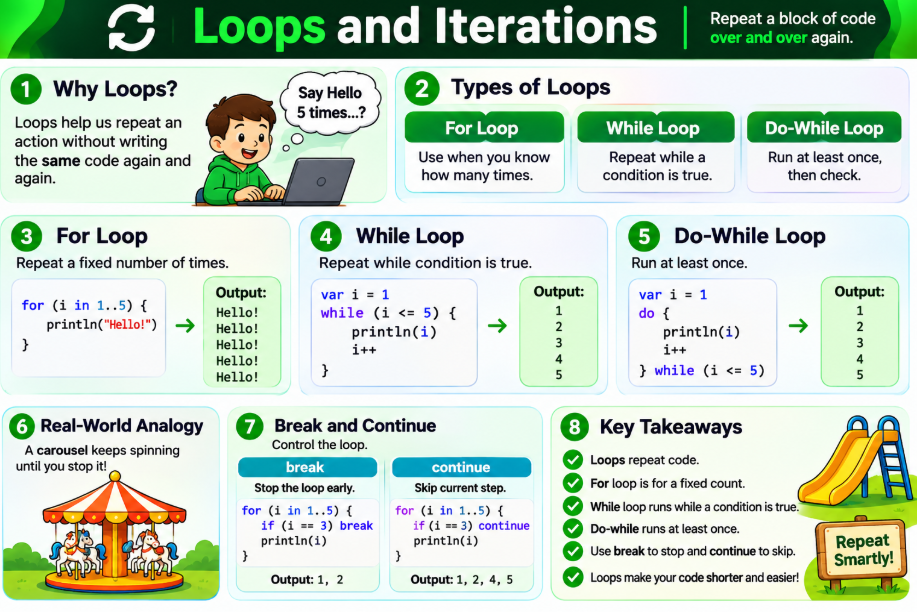

# Loops and Iterations



## 1. What is a Loop?

A loop allows us to execute the same block of code
multiple times without writing it repeatedly.

An iteration is one complete execution of the loop body.

### Real-World Analogy

Imagine doing 10 push-ups.

Instead of writing instructions for every push-up,
you simply say: "Repeat the push-up 10 times."

That is exactly how a loop works.

## 2. Types of Loops

| Loop | Purpose |
|---|---|
| for | Repeat for a known number of times or elements |
| while | Repeat while a condition is true |
| do-while | Execute at least once, then check the condition |
| forEach | Perform an action for each element |
| Nested Loop | A loop inside another loop |
| Infinite Loop | Repeat indefinitely unless stopped |

---

## 3. For Loop

Used when we know how many times we want to repeat
an operation or have a collection to iterate over.

### Kotlin

```kotlin
for (i in 1..5) {
    println(i)
}
```

### Java / C++

```cpp
for (int i = 1; i <= 5; i++) {
    // Execute operation
}
```

Output of the Kotlin example:

```text
1 2 3 4 5
```

A traditional for loop has three parts:

- Initialization: `int i = 1`
- Condition: `i <= 5`
- Update: `i++`

## 4. While Loop

Repeats as long as the condition is true.

```kotlin
var i = 1

while (i <= 5) {
    println(i)
    i++
}
```

Output:

```text
1 2 3 4 5
```

The condition is checked BEFORE executing
the loop body.

If the condition is initially false,
the loop never executes.

## 5. Do-While Loop

Executes the loop body first and then
checks the condition.

```kotlin
var i = 10

do {
    println(i)
    i++
} while (i <= 5)
```

Output:

```text
10
```

Even though the condition is false,
the loop executes at least once.

### While vs Do-While

| While | Do-While |
|---|---|
| Checks condition first | Checks condition afterward |
| May execute zero times | Executes at least once |

## 6. For-Each Loop

Used to visit every element in a collection.

### Kotlin

```kotlin
val fruits = listOf("Apple", "Banana", "Mango")

for (fruit in fruits) {
    println(fruit)
}
```

Using Kotlin's forEach function:

```kotlin
fruits.forEach { fruit ->
    println(fruit)
}
```

### Java

```java
String[] fruits = {"Apple", "Banana", "Mango"};

for (String fruit : fruits) {
    System.out.println(fruit);
}
```

### C++

```cpp
std::vector<int> numbers = {10, 20, 30};

for (int number : numbers) {
    std::cout << number << " ";
}
```

## 7. Loop Control Statements

### Break

Immediately stops the loop.

```kotlin
for (i in 1..5) {
    if (i == 3) break

    println(i)
}
```

Output:

```text
1 2
```

### Continue

Skips the current iteration and moves to the next.

```kotlin
for (i in 1..5) {
    if (i == 3) continue

    println(i)
}
```

Output:

```text
1 2 4 5
```

### Return

Exits the current function, not just the loop.

```kotlin
fun printNumbers() {
    for (i in 1..5) {
        if (i == 3) return

        println(i)
    }

    println("Finished")
}
```

Output:

```text
1 2
```

"Finished" is never printed.

## 8. Nested Loops

A nested loop is a loop inside another loop.

```kotlin
for (i in 1..3) {
    for (j in 1..3) {
        print("* ")
    }

    println()
}
```

Output:

```text
* * *
* * *
* * *
```

The outer loop executes 3 times.
The inner loop executes 3 times for each outer iteration.

Total inner iterations = 3 x 3 = 9.

Nested loops are commonly used for matrices,
patterns and multidimensional arrays.

## 9. Infinite Loop

A loop that continues indefinitely unless stopped.

```kotlin
while (true) {
    println("Running...")
}
```

An infinite loop can also happen accidentally.

```kotlin
var i = 1

while (i <= 5) {
    println(i)

    // Forgot to increment i!
}
```

Avoid running infinite loops on the Android main
thread because they can freeze the application.

## 10. Forward, Reverse and Step Iteration

### Forward

```kotlin
for (i in 1..5) {
    print("$i ")
}
```

Output: 1 2 3 4 5

### Reverse

```kotlin
for (i in 5 downTo 1) {
    print("$i ")
}
```

Output: 5 4 3 2 1

### Step

```kotlin
for (i in 1..10 step 2) {
    print("$i ")
}
```

Output: 1 3 5 7 9

### Exclusive Upper Boundary

```kotlin
for (i in 0 until 5) {
    print("$i ")
}
```

Output: 0 1 2 3 4

The upper boundary (5) is excluded.

## 11. Real-World Android Example

Imagine receiving a list of vehicles from an API
and displaying their names.

```kotlin
val vehicles = listOf("Jeep", "RAM", "Dodge")

for (vehicle in vehicles) {
    println(vehicle)
}
```

Loops are commonly used for:

- Processing API responses.
- Searching through collections.
- Validating form inputs.
- Processing sensor readings.
- Preparing data for RecyclerView.

## 12. Loop Time Complexity

The number of iterations affects how much work
an algorithm performs.

### Single Loop — O(n)

```kotlin
for (i in 0 until n) {
    println(i)
}
```

### Nested Loop — O(n²)

```kotlin
for (i in 0 until n) {
    for (j in 0 until n) {
        println("$i, $j")
    }
}
```

### Doubling Loop — O(log n)

```kotlin
var i = 1L

while (i < n) {
    i *= 2
}
```

The variable doubles during every iteration.

For these examples, assume n is a positive Int
and each loop operation takes constant time.

## 13. Common Mistakes

### Off-by-One Error

Accessing an invalid array index.

```kotlin
val numbers = intArrayOf(10, 20, 30)

// Wrong
for (i in 0..numbers.size) {
    println(numbers[i])
}
```

Correct:

```kotlin
for (i in numbers.indices) {
    println(numbers[i])
}
```

### Forgetting to Update the Loop Variable

```kotlin
var i = 0

while (i < 5) {
    println(i)
    i++ // Do not forget this!
}
```

## 14. Key Takeaways

- Loop = repeat a block of code.
- Iteration = one execution of the loop body.
- for = iterate over a range or collection.
- while = check first, execute afterward.
- do-while = execute first, check afterward.
- break = stop the loop.
- continue = skip the current iteration.
- return = exit the function.
- Nested loops are loops inside other loops.
- Incorrect loop conditions can cause infinite loops.