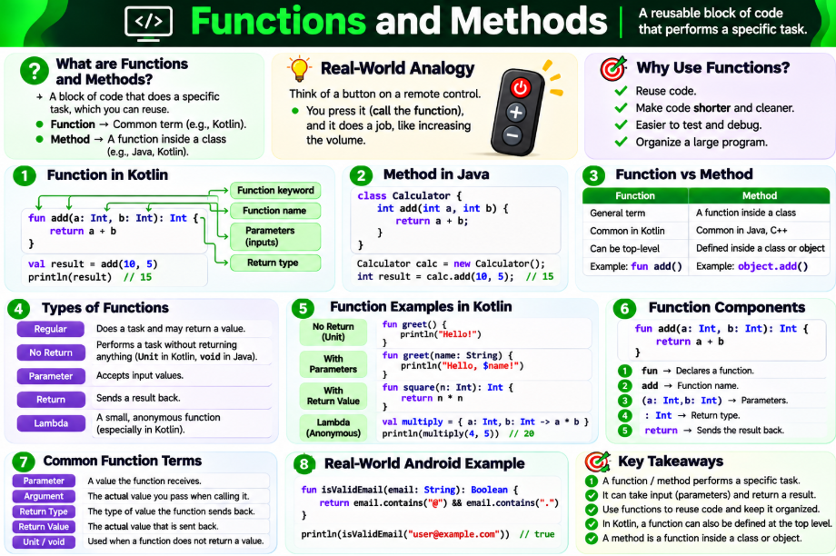

# Functions and Methods



## 1. What is a Function?

A function is a reusable block of code designed
to perform a specific task.

Instead of writing the same code repeatedly,
we write it once and call it whenever needed.

### Real-World Analogy

Think of a washing machine.

- Input: Dirty clothes
- Process: Washing
- Output: Clean clothes

A function works in a similar way.

## 2. Basic Structure of a Function

```kotlin
fun add(a: Int, b: Int): Int {
    return a + b
}

val result = add(10, 5)

println(result) // 15
```

| Component | Example |
|---|---|
| Function keyword | fun |
| Function name | add |
| Parameters | a, b |
| Parameter types | Int |
| Return type | Int |
| Function body | return a + b |
| Function call | add(10, 5) |
| Arguments | 10, 5 |

## 3. Function vs Method

A function is a reusable block of code.

A method is a function associated with a class
or an object.

### Function

```kotlin
fun greet() {
    println("Hello!")
}

greet()
```

### Method

```kotlin
class Car {

    fun startEngine() {
        println("Engine started")
    }
}

val car = Car()

car.startEngine()
```

Here, startEngine() is a method because
it belongs to the Car class.

| Function | Method |
|---|---|
| Can exist independently | Associated with a class or object |
| Called directly | Often called through an object |
| greet() | car.startEngine() |

The exact terminology varies between languages.

## 4. Four Basic Types of Functions

### No Parameters, No Return Value

```kotlin
fun greet() {
    println("Hello")
}

greet()
```

### Parameters, No Return Value

```kotlin
fun greet(name: String) {
    println("Hello $name")
}

greet("Alex")
```

### No Parameters, Returns a Value

```kotlin
fun getNumber(): Int {
    return 100
}

println(getNumber()) // 100
```

### Parameters and Return Value

```kotlin
fun multiply(a: Int, b: Int): Int {
    return a * b
}

println(multiply(5, 3)) // 15
```

## 5. Functions in Different Languages

### Kotlin

```kotlin
fun add(a: Int, b: Int): Int {
    return a + b
}
```

### Java

```java
static int add(int a, int b) {
    return a + b;
}
```

Java declares methods inside classes.

### C++

```cpp
int add(int a, int b) {
    return a + b;
}
```

### Python

```python
def add(a, b):
    return a + b
```

The syntax is different, but the basic concept
remains the same.

## 6. Return Statement

The return statement exits a function and
optionally sends a value back to the caller.

```kotlin
fun square(number: Int): Int {
    return number * number
}

val result = square(5)

println(result) // 25
```

If a function does not return a meaningful value:

- Kotlin uses Unit.
- Java uses void.
- C++ uses void.

## 7. Default Parameters

Default parameters provide a value when
an argument is not supplied.

```kotlin
fun greet(name: String = "Guest") {
    println("Hello $name")
}

greet()        // Hello Guest
greet("Alex")  // Hello Alex
```

## 8. Named Arguments

Kotlin allows us to specify arguments by name.

```kotlin
fun createUser(name: String, age: Int) {
    println("$name is $age years old")
}

createUser(age = 25, name = "Alex")
```

This makes function calls easier to understand.

## 9. Variable Number of Arguments (vararg)

Used when we want to accept multiple arguments
without specifying their exact count.

```kotlin
fun sum(vararg numbers: Int): Int {
    return numbers.sum()
}

println(sum(1, 2))       // 3
println(sum(1, 2, 3, 4)) // 10
```

## 10. Single-Expression Functions

Kotlin allows simple functions to be written
in a single line.

Traditional function:

```kotlin
fun square(x: Int): Int {
    return x * x
}
```

Shorter version:

```kotlin
fun square(x: Int): Int = x * x
```

Both perform the same task.

## 11. Function Overloading

Multiple functions can have the same name
but different parameter signatures.

```kotlin
fun add(a: Int, b: Int): Int {
    return a + b
}

fun add(a: Int, b: Int, c: Int): Int {
    return a + b + c
}

println(add(2, 3))    // 5
println(add(2, 3, 4)) // 9
```

The compiler determines which function
to call based on the arguments.

## 12. How Does a Function Execute?

```kotlin
fun add(a: Int, b: Int): Int {
    return a + b
}

fun main() {
    val result = add(10, 5)
    println(result)
}
```

Execution flow:

```text
main()
   |
   | Calls add(10, 5)
   v
add(a = 10, b = 5)
   |
   | Calculates 10 + 5
   |
   | Returns 15
   v
main()
   |
   v
Prints 15
```

Function calls are typically managed using
a call stack.

## 13. Real-World Android Example

Imagine an application that validates login details.

```kotlin
fun isValidLogin(email: String, password: String): Boolean {
    return email.isNotBlank() && password.length >= 8
}

val isValid = isValidLogin(
    "user@example.com",
    "password123"
)

println(isValid) // true
```

Instead of repeating the validation logic
throughout the application, we reuse the function.

This example checks basic input requirements,
not actual user authentication.

## 14. Why Do We Need Functions?

- Code reusability
- Reduced code duplication
- Easier debugging
- Easier unit testing
- Better code organization
- Separation of responsibilities

## 15. Best Practices

- Give functions meaningful names.
- Make each function perform one clear task.
- Avoid unnecessarily long functions.
- Avoid too many parameters.
- Avoid duplicate logic.

## 16. Key Takeaways

- Function = reusable block of code.
- Method = function associated with a class or object.
- Parameters receive input.
- Arguments are actual values passed to a function.
- Return sends a result back to the caller.
- Overloading allows the same function name with
  different parameter signatures.

## 17. Related Concepts

- Parameters and Arguments
- Scope and Lifetime
- Function Overloading
- Method Overriding
- Recursion
- Lambda Expressions
- Higher-Order Functions
- Pure Functions
- Call Stack