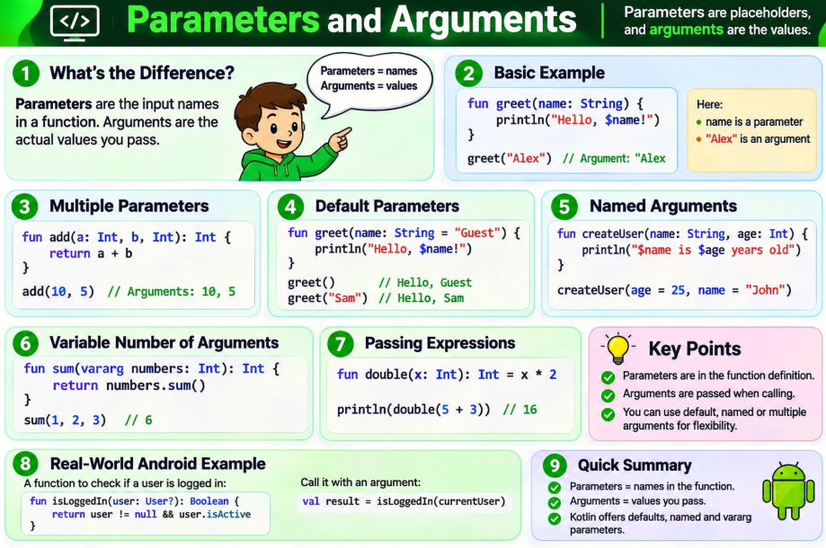

# Parameters and Arguments



## 1. What are Parameters and Arguments?

- **Parameter:** A variable defined in a function that receives a value.
- **Argument:** The actual value passed to a function when calling it.

```kotlin
fun greet(name: String) {
    println("Hello $name")
}

greet("Alex")
```

Here:
- `name` is the parameter.
- `"Alex"` is the argument.

## 2. Real-World Analogy

Imagine ordering a pizza at a restaurant.

The restaurant asks for:
- Pizza size
- Topping

These are parameters.

You order:
- Large
- Cheese

These are arguments.

Parameters describe what is expected.
Arguments provide the actual information.

## 3. Multiple Parameters and Arguments

```kotlin
fun add(a: Int, b: Int): Int {
    return a + b
}

println(add(10, 20)) // 30
```

- Parameters: a, b
- Arguments: 10, 20

## 4. Positional Arguments

Arguments are matched to parameters based
on their position.

```kotlin
fun introduce(name: String, age: Int) {
    println("$name is $age years old")
}

introduce("Alex", 25)
```

Output: Alex is 25 years old.

The order of arguments matters.

## 5. Named Arguments

Arguments are matched using parameter names.

```kotlin
introduce(age = 25, name = "Alex")
```

The order does not matter because we
explicitly specify the parameter names.

## 6. Default Parameters

A parameter can have a default value.

```kotlin
fun greet(name: String = "Guest") {
    println("Hello $name")
}

greet()       // Hello Guest
greet("Alex") // Hello Alex
```

If no argument is provided, the default
value is used.

## 7. Variable-Length Arguments (vararg)

Allows a function to accept a variable
number of arguments.

```kotlin
fun add(vararg numbers: Int): Int {
    return numbers.sum()
}

println(add(10, 20))     // 30
println(add(10, 20, 30)) // 60
```

## 8. Parameters and Arguments in Java

```java
static int add(int a, int b) {
    return a + b;
}

add(10, 20);
```

## 9. Parameters and Arguments in C++

```cpp
int add(int a, int b) {
    return a + b;
}

add(10, 20);
```

The concept remains the same across languages.

## 10. Pass by Value vs Pass by Reference

These describe how arguments are passed
to function parameters.

### Pass by Value (C++)

The function receives a copy of the value.

```cpp
void update(int x) {
    x = 100;
}

int number = 10;
update(number);

// number is still 10
```

### Pass by Reference (C++)

The parameter refers to the original variable.

```cpp
void update(int& x) {
    x = 100;
}

int number = 10;
update(number);

// number is now 100
```

Kotlin and Java pass arguments by value,
including copies of object references.

This concept will be covered in detail
in a separate chapter.

## 11. Real-World Android Example

```kotlin
fun showMessage(message: String) {
    Toast.makeText(
        this,
        message,
        Toast.LENGTH_SHORT
    ).show()
}

// Called inside an Activity
showMessage("Login successful")
showMessage("No internet connection")
```

The same method can display different messages
depending on the argument provided.

## 12. Key Differences

| Parameter | Argument |
|---|---|
| Defined in a function declaration | Provided during a function call |
| Receives a value | Supplies a value |
| Placeholder | Actual input |
| fun greet(name: String) | greet("Alex") |
| Also called formal parameter | Also called actual argument |

## 13. Key Takeaways

- Parameter = what a function expects.
- Argument = what a function receives from the caller.
- Positional arguments depend on their order.
- Named arguments use parameter names.
- Default parameters provide fallback values.
- vararg accepts a variable number of arguments.