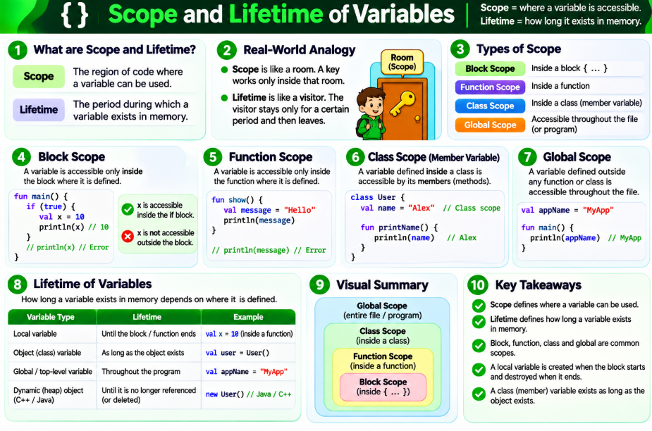

# Scope and Lifetime of Variables



## 1. What are Scope and Lifetime?

- **Scope:** Where a variable can be accessed in code.
- **Lifetime:** How long a variable exists during program execution.

### Real-World Analogy

Imagine a classroom.

- Scope: A classroom whiteboard can be accessed
  by students inside that classroom.
- Lifetime: Temporary writing on the whiteboard
  exists until it is erased.

Scope is about WHERE.
Lifetime is about HOW LONG.

## 2. Local Scope

A variable declared inside a function can only
be accessed within that function.

```kotlin
fun greet() {
    val name = "Alex"
    println(name) // Allowed
}

fun main() {
    greet()
    println(name) // Error
}
```

The variable name belongs to the greet() function.

## 3. Block Scope

A variable declared inside a block of code
is accessible only within that block.

```kotlin
if (true) {
    val score = 100
    println(score) // Allowed
}

println(score) // Error
```

The same rule applies to loops.

```kotlin
for (i in 1..5) {
    println(i) // Allowed
}

println(i) // Error
```

## 4. Global / Top-Level Scope

A variable declared outside functions and classes
can be accessed by multiple functions, subject
to visibility rules.

```kotlin
var score = 0

fun increaseScore() {
    score++
}

fun displayScore() {
    println(score)
}
```

Both functions can access score.

Avoid unnecessary global mutable variables
because they make application state harder to manage.

## 5. Class Scope

A property declared inside a class can be accessed
by its methods, subject to access modifiers.

```kotlin
class Car {

    private var speed = 0

    fun accelerate() {
        speed += 10
    }

    fun displaySpeed() {
        println(speed)
    }
}
```

Both methods can access speed.

However, code outside the class cannot directly
access it because it is private.

## 6. Variable Shadowing

Shadowing happens when an inner variable has
the same name as an outer variable.

```kotlin
val number = 10

fun main() {
    val number = 20

    println(number) // 20
}
```

The inner variable hides the outer variable
within its scope.

## 7. What is Variable Lifetime?

Lifetime describes how long a variable
or its storage exists during execution.

```kotlin
fun counter() {
    var count = 0

    count++
    println(count)
}

fun main() {
    counter() // 1
    counter() // 1
    counter() // 1
}
```

Each function call creates a new local count.

It does not remember the previous value.

## 8. Static Variable Lifetime

A static local variable in C++ retains its
value between function calls.

```cpp
void counter() {
    static int count = 0;

    count++;
    std::cout << count << std::endl;
}

int main() {
    counter(); // 1
    counter(); // 2
    counter(); // 3
}
```

The variable has local scope but static
storage duration.

This demonstrates that scope and lifetime
are different concepts.

## 9. Object Lifetime

An object can continue to exist even after
the function that created it has finished.

```kotlin
data class User(val name: String)

fun createUser(): User {
    val user = User("Alex")
    return user
}

fun main() {
    val person = createUser()
    println(person.name) // Alex
}
```

The local variable user is no longer accessible,
but the object still exists because person
references it.

On Kotlin/JVM, unreachable objects become
eligible for garbage collection.

## 10. Scope vs Lifetime

| Scope | Lifetime |
|---|---|
| Where can it be accessed? | How long does it exist? |
| Controls accessibility | Relates to storage duration |
| Determined by language scope rules | Depends on execution and storage |
| Local, block, class, global | Automatic, static, object lifetime |

## 11. Real-World Android Example

```kotlin
class MainActivity : AppCompatActivity() {

    private var clickCount = 0

    fun onButtonClicked() {
        val message = "Button clicked"

        clickCount++

        println(message)
        println(clickCount)
    }
}
```

- message: Local to onButtonClicked().
- clickCount: A property of the Activity instance.
- message is initialized on every function call.
- clickCount retains its value between calls.

If the Activity is recreated, clickCount is
initialized again unless its state is restored.

## 12. Key Takeaways

- Scope = WHERE a variable can be accessed.
- Lifetime = HOW LONG a variable exists.
- Local variables belong to their local scope.
- Class properties belong to an object or class.
- Static local variables can retain their values
  between function calls.
- An object's lifetime can exceed the scope
  of the variable that originally referenced it.
- Scope and lifetime are not the same thing.