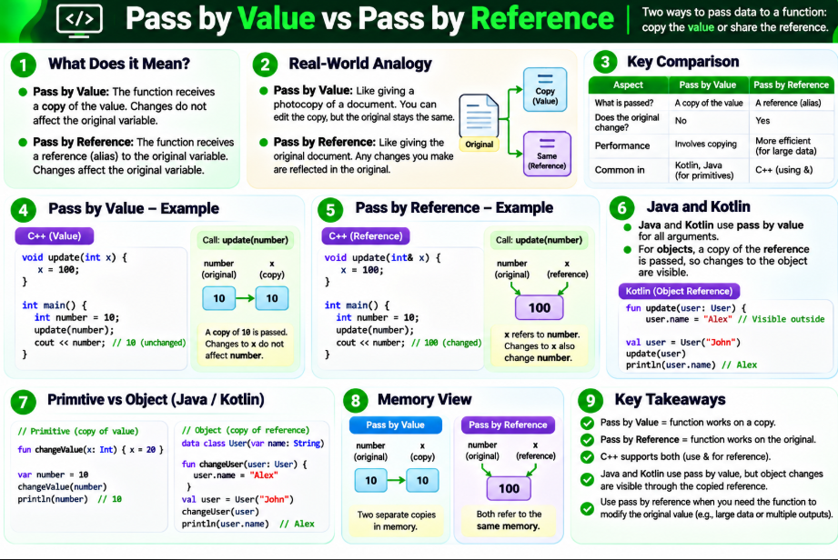

# Pass by Value vs Pass by Reference



## 1. What is Pass by Value and Pass by Reference?

When we pass a variable to a function, how does
the function receive it?

- **Pass by Value:** The function receives a copy of the value.
- **Pass by Reference:** The function receives access to the original variable through a reference.

The main difference is whether the function
can directly modify the caller's original variable.

## 2. Real-World Analogy

Imagine you have a notebook.

### Pass by Value

You give your friend a photocopy of your notebook.

Your friend can write on the photocopy, but
your original notebook remains unchanged.

### Pass by Reference

You give your friend access to your original notebook.

Whatever your friend writes changes your
original notebook.

---

## 3. Pass by Value (C++)

```cpp
#include <iostream>
using namespace std;

void update(int x) {
    x = 100;
}

int main() {
    int number = 10;

    update(number);

    cout << number; // 10
}
```

### How does it work?

```text
Original Variable       Function Parameter

number                  x
+------+                +------+
|  10  | ---- COPY ---> |  10  |
+------+                +------+
                            |
                            v
                        +------+
                        | 100  |
                        +------+

Original number remains 10.
```

The function modifies its own copy.
The original variable remains unchanged.

---

## 4. Pass by Reference (C++)

```cpp
#include <iostream>
using namespace std;

void update(int& x) {
    x = 100;
}

int main() {
    int number = 10;

    update(number);

    cout << number; // 100
}
```

Notice the `&` in the function parameter.

```cpp
void update(int& x)
```

It means x is another name (alias) for
the original variable.

### How does it work?

```text
number --------+
               |
               v
           +------+
           |  10  |
           +------+
               ^
               |
x -------------+

After x = 100:

           +------+
           | 100  |
           +------+
```

Both number and x refer to the same variable.

Changing x also changes number.

---

## 5. Passing Pointers in C++

We can also modify the original variable
by passing its memory address.

```cpp
#include <iostream>
using namespace std;

void update(int* x) {
    *x = 100;
}

int main() {
    int number = 10;

    update(&number);

    cout << number; // 100
}
```

Here:

- `&number` obtains the address of number.
- `int* x` receives a copy of that address.
- `*x` accesses the original value at that address.

Technically, the pointer itself is passed by value,
but it allows us to modify the original variable.

## 6. Comparing All Three Approaches

```cpp
void byValue(int x) {
    x = 100;
}

void byReference(int& x) {
    x = 100;
}

void byPointer(int* x) {
    *x = 100;
}
```

```cpp
int a = 10;
int b = 10;
int c = 10;

byValue(a);
byReference(b);
byPointer(&c);

cout << a; // 10
cout << b; // 100
cout << c; // 100
```

| Approach | Parameter | Function Call | Original Changed? |
|---|---|---|---|
| Value | int x | update(a) | No |
| Reference | int& x | update(a) | Yes |
| Pointer | int* x | update(&a) | Yes |

---

## 7. Pass by Value in Java

Java is always pass by value.

### Primitive Values

```java
static void update(int x) {
    x = 100;
}

public static void main(String[] args) {
    int number = 10;

    update(number);

    System.out.println(number); // 10
}
```

The function receives a copy of the integer.

### Objects

```java
class User {
    String name = "Alex";
}

static void update(User user) {
    user.name = "Sam";
}
```

```java
User person = new User();

update(person);

System.out.println(person.name); // Sam
```

Wait! If Java is pass by value, why did
the original object change?

Because Java passes a COPY of the object reference.

Both references point to the same object.

```text
person --------+
               |
               v
          +-------------+
          | User Object |
          | name = Sam  |
          +-------------+
               ^
               |
user ----------+
```

The object is not copied.
Only its reference is copied.

---

## 8. Pass by Value in Kotlin

Kotlin also passes arguments by value.

When passing an object, the function receives
a copy of its reference.

```kotlin
data class User(var name: String)

fun update(user: User) {
    user.name = "Sam"
}

fun main() {
    val person = User("Alex")

    update(person)

    println(person.name) // Sam
}
```

Both references point to the same User object.

However, Kotlin function parameters cannot
be reassigned.

```kotlin
fun update(user: User) {
    user = User("John") // Compilation error
}
```

Modifying an object and reassigning
a reference are two different operations.

---

## 9. Why Java Is NOT Pass by Reference

Consider this Java example:

```java
static void replace(User user) {
    user = new User();
    user.name = "Sam";
}
```

```java
User person = new User();
person.name = "Alex";

replace(person);

System.out.println(person.name); // Alex
```

The function changes its own copy of
the reference, not the caller's reference.

```text
Before:

person ----> User("Alex")
user   ----> User("Alex")


After reassignment:

person ----> User("Alex")
user   ----> User("Sam")
```

If Java supported true pass by reference,
the function could replace the caller's
original reference directly.

---

## 10. Real-World Example: Swapping Two Numbers

### Incorrect: Pass by Value

```cpp
void swapNumbers(int a, int b) {
    int temp = a;
    a = b;
    b = temp;
}
```

The original numbers remain unchanged.

### Correct: Pass by Reference

```cpp
void swapNumbers(int& a, int& b) {
    int temp = a;
    a = b;
    b = temp;
}

int x = 10;
int y = 20;

swapNumbers(x, y);

// x = 20
// y = 10
```

This is a common use of pass by reference.

---

## 11. Const Reference in C++

Sometimes we want to avoid copying a large
object without allowing the function to
modify it through the parameter.

```cpp
void display(const std::string& name) {
    std::cout << name;
}
```

Benefits:

- Avoids unnecessary object copying.
- Prevents modification through the reference.
- Useful for large objects and collections.

---

## 12. Key Differences

| Feature | Pass by Value | Pass by Reference |
|---|---|---|
| Receives | Copy of value | Alias to original variable |
| Directly modifies original variable | No | Yes |
| Copies large value objects | May require copying | Avoids copying |
| Accidental modification risk | Lower for independent values | Higher |
| C++ syntax | int x | int& x |

## 13. How Different Languages Work

| Language | Parameter Passing |
|---|---|
| C | Pass by value, including pointers |
| C++ | Pass by value and reference |
| Java | Pass by value, including object references |
| Kotlin | Pass by value, including object references |
| Python | Object sharing (pass by assignment) |
| JavaScript | Pass by value, including object references |

## 14. Interview Questions

**Q: Is Java pass by reference?**

No. Java is always pass by value.

**Q: Why can Kotlin functions modify objects?**

Because the copied reference points to
the same object.

**Q: Does passing a pointer copy the entire object?**

No. It copies the pointer value (address).

**Q: Why use const references in C++?**

To avoid unnecessary copying while preventing
modification through the reference.

## 15. Key Takeaways

- Pass by value = copy the value.
- Pass by reference = access the original variable.
- A copied object reference is not a copied object.
- C++ supports true pass by reference.
- Java and Kotlin pass object references by value.
- Modifying an object is different from
  reassigning a reference.