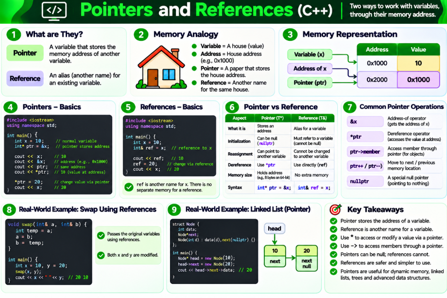

# Pointers and References



## 1. What are Pointers and References?

Every variable occupies storage somewhere in memory.

- **Pointer:** A variable that stores a memory address.
- **Reference in C++:** Another name (alias) for an existing variable.

### Real-World Analogy

Imagine a house.

- Variable = House
- Value = Contents of the house
- Memory address = Address of the house
- Pointer = A piece of paper containing the address
- C++ Reference = Another name for the same house

A pointer helps you locate a variable without
having to copy its contents.

---

## 2. Understanding Memory Addresses

```cpp
int number = 10;

cout << number;  // 10
cout << &number; // Memory address
```

Imagine the following memory representation:

```text
Variable: number
Address:  0x1000
Value:    10

Memory
+-----------+---------+
| Address   | Value   |
+-----------+---------+
| 0x1000    | 10      |
+-----------+---------+
```

The `&` operator returns the address of a variable.

The address shown here is hypothetical.

---

## 3. What is a Pointer?

A pointer stores the address of another variable.

```cpp
int number = 10;

int* ptr = &number;
```

Memory representation:

```text
ptr                         number
+----------+                +------+
| 0x1000   | -------------> |  10  |
+----------+                +------+
                            0x1000
```

- `number` contains 10.
- `&number` gives its address.
- `ptr` stores that address.
- `*ptr` accesses the value at that address.

```cpp
cout << number;  // 10
cout << &number; // 0x1000 (example)
cout << ptr;     // 0x1000 (example)
cout << *ptr;    // 10
cout << &ptr;    // Address of the pointer itself
```

A pointer is also a variable, so it has its
own memory address.

---

## 4. Dereferencing a Pointer (*)

Dereferencing means accessing the value
stored at the address held by a pointer.

```cpp
int number = 10;
int* ptr = &number;

cout << *ptr; // 10
```

We can also modify the original variable.

```cpp
*ptr = 50;

cout << number; // 50
```

```text
Before:

ptr ---------> number [10]

After *ptr = 50:

ptr ---------> number [50]
```

The pointer still holds the same address.
Only the value at that address has changed.

---

## 5. What is a Reference in C++?

A reference is another name for an
existing variable.

```cpp
int number = 10;

int& ref = number;
```

```text
number -----+
            |
            v
          [ 10 ]
            ^
            |
ref --------+
```

Both names access the same variable.

```cpp
ref = 50;

cout << number; // 50
cout << ref;    // 50
```

Unlike a pointer, a reference does not
require dereferencing with `*`.

---

## 6. Understanding the * and & Symbols

These symbols have different meanings
depending on where they are used.

| Syntax | Meaning |
|---|---|
| `int* ptr` | Declare an integer pointer |
| `&number` | Obtain the address of number |
| `*ptr` | Access the pointed-to value |
| `int& ref` | Declare an integer reference |

```cpp
int number = 10;

int* ptr = &number;
int& ref = number;

*ptr = 20;
ref = 30;

cout << number; // 30
```

Both ptr and ref provide access to
the original variable.

---

## 7. Can a Pointer Point to Another Variable?

Yes.

```cpp
int a = 10;
int b = 20;

int* ptr = &a;

cout << *ptr; // 10

ptr = &b;

cout << *ptr; // 20
```

```text
Before:

ptr ---------> a [10]

               b [20]

After:

               a [10]

ptr ---------> b [20]
```

A C++ reference cannot be redirected
after initialization.

```cpp
int a = 10;
int b = 20;

int& ref = a;

ref = b;
```

This copies the value of b into a.
It does not make ref refer to b.

---

## 8. Null Pointer

A null pointer does not point to any object.

```cpp
int* ptr = nullptr;
```

```text
ptr ---------> Nothing
```

Always check a potentially null pointer
before dereferencing it.

```cpp
if (ptr != nullptr) {
    cout << *ptr;
}
```

Dereferencing a null pointer causes
undefined behavior in C++.

---

## 9. Pointer Arithmetic

Pointers can move between elements
of the same array.

```cpp
int numbers[] = {10, 20, 30};

int* ptr = numbers;

cout << *ptr;       // 10
cout << *(ptr + 1); // 20
cout << *(ptr + 2); // 30
```

Assuming each integer occupies 4 bytes:

```text
Address:  0x1000    0x1004    0x1008

Array:    [ 10 ]    [ 20 ]    [ 30 ]
             ^         ^         ^
            ptr      ptr+1     ptr+2
```

Adding 1 to an integer pointer moves it
to the next integer, not the next byte.

Pointer arithmetic must respect array boundaries.

---

## 10. Pointer to a Pointer

A pointer can also store the address
of another pointer.

```cpp
int number = 10;

int* ptr = &number;
int** doublePtr = &ptr;

cout << **doublePtr; // 10
```

```text
doublePtr -----> ptr -----> number [10]
```

- `*ptr` accesses number.
- `*doublePtr` accesses ptr.
- `**doublePtr` accesses number.

---

## 11. The Arrow Operator (->)

The arrow operator accesses a member
of an object through a pointer.

```cpp
struct Node {
    int data;
};

Node node{10};

Node* ptr = &node;

cout << ptr->data; // 10
```

These two expressions are equivalent:

```cpp
ptr->data

(*ptr).data
```

The arrow operator is shorthand for
dereferencing a pointer and accessing
a member of the resulting object.

---

## 12. Real-World Example: Linked List

Pointers allow objects to be connected.

```cpp
class Node {
public:
    int data;
    Node* next;

    Node(int value) {
        data = value;
        next = nullptr;
    }
};

Node first(10);
Node second(20);
Node third(30);

first.next = &second;
second.next = &third;
```

Visualization:

```text
+-----------+    +-----------+    +-----------+
| Data: 10  |    | Data: 20  |    | Data: 30  |
| Next: ----+--->| Next: ----+--->| Next: null|
+-----------+    +-----------+    +-----------+
```

Accessing the next node:

```cpp
cout << first.data;             // 10
cout << first.next->data;       // 20
cout << first.next->next->data; // 30
```

This is how linked lists connect nodes.

Pointers are also commonly used in
trees and graphs.

---

## 13. References in Kotlin and Java

Kotlin and Java do not provide ordinary
raw pointers like C++.

Instead, variables can hold references
to objects.

### Kotlin

```kotlin
data class User(var name: String)

val user1 = User("Alex")
val user2 = user1

user2.name = "Sam"

println(user1.name) // Sam
println(user2.name) // Sam
```

```text
user1 -------+
             |
             v
       +-------------+
       | User Object |
       | name = Sam  |
       +-------------+
             ^
             |
user2 -------+
```

Both variables refer to the same object.

The object itself is not copied.

### Java

```java
User user1 = new User();
User user2 = user1;

user2.name = "Sam";

System.out.println(user1.name); // Sam
```

Unlike C++ references, Kotlin and Java
object references can be reassigned if
the variable allows reassignment.

---

## 14. Pointers vs References in C++

| Feature | Pointer | Reference |
|---|---|---|
| Declaration | `int* ptr` | `int& ref` |
| Purpose | Store an address | Alias an existing variable |
| Can be null? | Yes | No valid null reference |
| Can be redirected? | Yes | No |
| Requires dereferencing? | Yes | No |
| Supports pointer arithmetic? | Yes | No |
| Requires initialization? | Not always | Yes |

Always initialize pointers before using them.

---

## 15. Common Pointer Problems

### Null Pointer

```cpp
int* ptr = nullptr;

// *ptr; // Undefined behavior
```

### Uninitialized Pointer

```cpp
int* ptr;
```

This local pointer has not been initialized
with a valid address.

### Dangling Pointer

A pointer that refers to an object whose
lifetime has ended.

```cpp
int* ptr = new int(10);

delete ptr;

// ptr now holds a dangling address

ptr = nullptr;
```

Dereferencing a dangling pointer causes
undefined behavior.

Setting ptr to nullptr does not fix other
pointers that might refer to the same object.

Modern C++ provides smart pointers such as
unique_ptr and shared_ptr to help manage
object ownership and lifetime.

---

## 16. Interview Questions

**Q: What is a pointer?**

A variable that stores a memory address.

**Q: What is dereferencing?**

Accessing an object or value through a pointer.

**Q: What is a C++ reference?**

Another name for an existing variable or object.

**Q: What is the difference between *ptr and &ptr?**

*ptr accesses the pointed-to value.

&ptr obtains the address of the pointer itself.

**Q: What does ptr->data mean?**

It accesses the data member of the object
pointed to by ptr.

**Q: Does Java support raw pointers?**

Not in ordinary Java code. It uses managed
object references instead.

## 17. Key Takeaways

- Pointer = stores a memory address.
- C++ reference = another name for a variable.
- & = address-of operator (in expressions).
- * = dereference operator (in expressions).
- -> = access an object's member through a pointer.
- nullptr = pointer that does not point to an object.
- Pointers can be redirected; C++ references cannot.
- Kotlin and Java use managed object references.
- Multiple references can point to the same object.