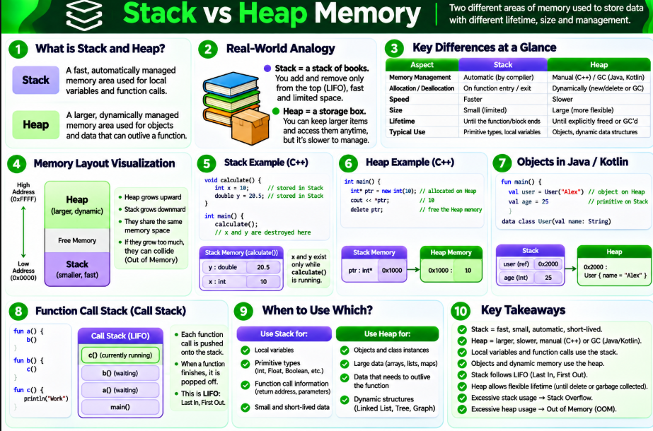

# Stack vs Heap Memory



## 1. What are Stack and Heap Memory?

Stack and Heap are two areas of memory commonly
used by programs during execution.

- **Stack:** Stores function call information and
  typically local variables.
- **Heap:** Stores dynamically allocated objects
  and data.

Both are commonly located in RAM.

## 2. Real-World Analogy

### Stack — A Stack of Plates

Imagine a stack of plates in your kitchen.

- You place a new plate on top.
- You remove the top plate first.
- The last plate added is the first one removed.

This is called LIFO (Last In, First Out).

### Heap — A Storage Warehouse

Imagine a warehouse containing different boxes.

- Boxes can be placed in available spaces.
- You can access boxes using their locations.
- Boxes can remain there until they are removed.

Unlike the stack, the heap does not follow
the LIFO rule.

---

## 3. How Stack Memory Works

Whenever a function is called, a stack frame
is typically created for that function.

A stack frame may contain:

- Local variables
- Function parameters
- Return address
- Other execution information

```kotlin
fun add(a: Int, b: Int): Int {
    val result = a + b
    return result
}

fun main() {
    val number = add(10, 20)
    println(number)
}
```

Conceptual stack while add() is executing:

```text
        STACK
+-------------------+
| add()             |
| a = 10            |
| b = 20            |
| result = 30       |
+-------------------+
| main()            |
+-------------------+
```

Once add() finishes, its stack frame
is removed.

```text
        STACK
+-------------------+
| main()            |
| number = 30       |
+-------------------+
```

Stack memory is automatically managed
as functions are called and return.

## 4. How Heap Memory Works

The heap is commonly used to store objects
that may need to exist beyond a function call.

```kotlin
data class User(val name: String, val age: Int)

fun main() {
    val user = User("Alex", 25)
}
```

Conceptual memory representation:

```text
       STACK                    HEAP
+----------------+       +-------------------+
| main()         |       | User Object       |
|                |       |                   |
| user reference | ----> | name = "Alex"     |
|                |       | age = 25          |
+----------------+       +-------------------+
```

The local variable holds a reference to
the User object.

The object is typically allocated on the heap
in Kotlin/JVM and Java.

## 5. Stack and Heap in C++

### Stack Allocation

```cpp
void example() {
    int number = 10;
}
```

The local variable has automatic storage duration
and is typically stored on the stack.

Its lifetime ends when the function finishes.

### Dynamic Allocation (Heap)

```cpp
void example() {
    int* ptr = new int(10);

    delete ptr;
}
```

Conceptual representation:

```text
       STACK                 HEAP
+----------------+     +-------------+
| ptr (address)  | --> |     10      |
+----------------+     +-------------+
```

- ptr is a local pointer.
- new allocates an integer dynamically.
- delete releases the dynamically allocated object.

Modern C++ generally prefers smart pointers
and automatic resource management over manual
new and delete.

## 6. Stack and Heap in Java

```java
class User {
    int age = 25;
}

public static void main(String[] args) {
    int number = 10;

    User user = new User();
}
```

Conceptually:

```text
        STACK                    HEAP
+-------------------+     +---------------+
| number = 10       |     | User Object   |
| user reference ---+---> | age = 25      |
+-------------------+     +---------------+
```

Java uses Garbage Collection to reclaim
unreachable heap objects automatically.

## 7. Can an Object Survive a Function Call?

Yes.

```kotlin
data class User(val name: String)

fun createUser(): User {
    val user = User("Alex")
    return user
}

fun main() {
    val person = createUser()

    println(person.name) // Alex
}
```

When createUser() finishes, its stack frame
is removed.

However, the User object still exists because
person holds a reference to it.

This is why object lifetime and function
lifetime are not necessarily the same.

## 8. Garbage Collection

In Java and Kotlin/JVM, the Garbage Collector
reclaims memory occupied by unreachable objects.

```kotlin
var user: User? = User("Alex")

user = null
```

If no other reachable reference to the object
exists, it becomes eligible for garbage collection.

The memory is not necessarily reclaimed immediately.

C++ generally manages object lifetime through
scope, ownership, destructors and smart pointers.

## 9. Stack Overflow

A stack overflow occurs when a program requires
more stack space than is available.

A common cause is uncontrolled recursion.

```kotlin
fun repeat() {
    repeat()
}

fun main() {
    repeat()
}
```

```text
+----------------+
| repeat()       |
+----------------+
| repeat()       |
+----------------+
| repeat()       |
+----------------+
| repeat()       |
+----------------+
| main()         |
+----------------+

Eventually: StackOverflowError
```

The function repeatedly calls itself without
a stopping condition.

## 10. Heap Out of Memory

If a program keeps allocating objects and
cannot reclaim enough memory, it may run
out of available heap space.

```kotlin
val objects = mutableListOf<ByteArray>()

while (true) {
    objects.add(ByteArray(1024 * 1024))
}
```

This continuously allocates and retains
large byte arrays.

Eventually, it may throw OutOfMemoryError.

This is an intentionally bad example.
Do not run it in a production application.

## 11. Memory Leaks in Android

A memory leak occurs when an object is no
longer needed but is still retained in memory.

For example, storing an Activity reference
inside a long-lived singleton.

```kotlin
object AppManager {
    var activity: Activity? = null
}
```

If the Activity is destroyed but AppManager
still references it, the Activity may remain
in memory unnecessarily.

Garbage Collection cannot reclaim objects
that are still strongly reachable.

Tools such as Android Studio Memory Profiler
and LeakCanary help detect memory leaks.

## 12. Stack vs Heap Comparison

| Feature | Stack | Heap |
|---|---|---|
| Purpose | Function calls and local storage | Dynamic object allocation |
| Organization | LIFO | No LIFO requirement |
| Allocation | Generally fast | Generally more overhead |
| Size | Typically smaller | Typically larger |
| Lifetime | Usually tied to function calls | Depends on object ownership or reachability |
| Management | Automatically managed | GC or explicit/automatic ownership |
| Thread access | Typically per-thread | Objects can be shared across threads |
| Common error | StackOverflowError | OutOfMemoryError |

## 13. Common Misconceptions

### All primitive values are stored on the stack.

False. A primitive value can also be stored
inside an object on the heap.

### All objects must physically exist on the heap.

Not necessarily. C++ supports automatic object
storage, and JVM optimizations may eliminate
some heap allocations.

### Garbage Collection prevents all memory leaks.

False. Unnecessary references can keep
unused objects reachable.

## 14. Key Takeaways

- Stack = function calls and temporary local storage.
- Heap = dynamically allocated data and objects.
- Stack follows the LIFO principle.
- Stack frames are removed when functions return.
- Heap objects can survive function calls.
- Java and Kotlin/JVM use Garbage Collection.
- C++ uses ownership and lifetime management.
- Stack overflow and heap exhaustion are different.
- Memory diagrams are conceptual; actual placement
  depends on the language, runtime and compiler.