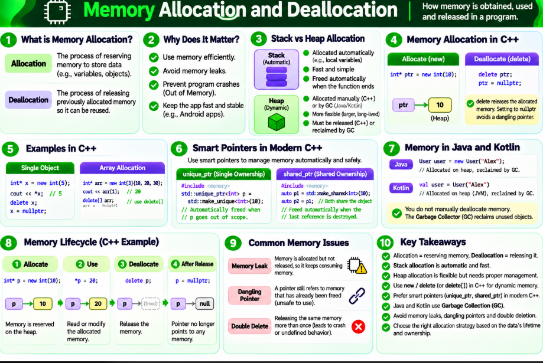

# Memory Allocation and Deallocation



## 1. What is Memory Allocation?

Memory allocation is the process of reserving
memory for variables, objects and other data.

Memory deallocation is the process of releasing
that memory so it can be reused.

## 2. Real-World Analogy

Imagine booking a hotel room.

- Allocation: Booking a room.
- Usage: Staying inside the room.
- Deallocation: Checking out and releasing the room.
- Memory leak: Leaving without checking out,
  keeping the room unnecessarily occupied.

Computer memory works in a similar way.

## 3. Types of Memory Allocation

| Type | Description |
|---|---|
| Static | Storage reserved for the program's lifetime |
| Automatic | Storage managed through local scopes |
| Dynamic | Memory allocated as needed during execution |

---

## 4. Static Memory Allocation

Variables with static storage duration exist
throughout the program's execution.

### C++

```cpp
static int count = 10;
```

A static local variable also retains its value
between function calls.

```cpp
void counter() {
    static int count = 0;
    count++;
    std::cout << count << " ";
}

counter(); // 1
counter(); // 2
counter(); // 3
```

## 5. Automatic Memory Allocation

Local variables are automatically created and
destroyed according to their scope.

### C++

```cpp
void calculate() {
    int number = 10;
    int result = number * 2;
}
```

When the function finishes, the lifetime of
number and result ends.

These variables are typically stored on the stack.

## 6. Dynamic Memory Allocation

Memory is allocated during program execution
when it is needed.

This is particularly useful when the required
amount of memory is not known beforehand.

### C++

```cpp
int* ptr = new int(10);
```

Conceptual memory representation:

```text
       STACK                 HEAP
+----------------+     +-------------+
| ptr (address)  | --> |     10      |
+----------------+     +-------------+
```

The new keyword dynamically allocates memory
and initializes the integer.

To release the memory:

```cpp
delete ptr;
ptr = nullptr;
```

## 7. Dynamic Arrays in C++

Imagine asking the user how many numbers
they want to store.

```cpp
int size;
std::cin >> size;

int* numbers = new int[size];

numbers[0] = 10;

delete[] numbers;
numbers = nullptr;
```

Assume size is a positive integer.

Use delete[] for arrays allocated using new[].

In modern C++, prefer std::vector for
dynamically sized arrays.

```cpp
std::vector<int> numbers(size);
```

The vector automatically manages its memory.

## 8. Memory Allocation in C

C provides four common memory management functions.

| Function | Purpose |
|---|---|
| malloc() | Allocates uninitialized memory |
| calloc() | Allocates zero-initialized memory |
| realloc() | Resizes an allocated memory block |
| free() | Releases allocated memory |

### malloc and free

```c
int* ptr = malloc(sizeof(int));

if (ptr != NULL) {
    *ptr = 10;

    free(ptr);
    ptr = NULL;
}
```

### calloc

```c
int* numbers = calloc(5, sizeof(int));

if (numbers != NULL) {
    free(numbers);
}
```

Allocates memory for five integers and
initializes their storage to zero.

### realloc

```c
int* numbers = malloc(5 * sizeof(int));

if (numbers != NULL) {
    int* temp = realloc(numbers, 10 * sizeof(int));

    if (temp != NULL) {
        numbers = temp;
    }

    free(numbers);
}
```

realloc attempts to resize an existing allocation.
It may move the allocation to a new address.

These examples require the stdlib.h header.

## 9. Memory Allocation in Java

```java
User user = new User();
```

The new keyword creates a User object.

Java automatically manages object memory
using Garbage Collection.

```java
user = null;
```

If the object is no longer reachable,
it becomes eligible for garbage collection.

Memory is not necessarily released immediately.

## 10. Memory Allocation in Kotlin

```kotlin
data class User(val name: String)

var user: User? = User("Alex")

user = null
```

Kotlin/JVM automatically manages object memory
using Garbage Collection.

Unlike C++, developers do not normally need
to manually release object memory.

## 11. Common Memory Problems

### Memory Leak

Memory remains occupied even though the
program no longer needs it.

```cpp
void example() {
    int* ptr = new int(10);

    // Forgot to delete ptr!
}
```

The allocated memory is leaked when the function
ends and the pointer is lost.

### Dangling Pointer

A pointer refers to memory that has already
been released.

```cpp
int* ptr = new int(10);

delete ptr;

// ptr is now a dangling pointer
```

### Double Free

Attempting to release the same allocation twice.

```cpp
int* ptr = new int(10);

delete ptr;
delete ptr; // Undefined behavior
```

### Out of Memory

Occurs when the program cannot obtain
enough memory for a new allocation.

### Memory Fragmentation

Free memory becomes divided into smaller blocks,
making some larger allocations difficult.

Imagine a parking lot with many empty spaces,
but no consecutive spaces for a large truck.

## 12. Smart Pointers in Modern C++

Smart pointers help automatically manage
dynamically allocated objects.

```cpp
#include <memory>

auto ptr = std::make_unique<int>(10);
```

The object is automatically destroyed when
its unique owner is destroyed.

| Smart Pointer | Purpose |
|---|---|
| unique_ptr | Single owner |
| shared_ptr | Multiple shared owners |
| weak_ptr | Non-owning reference to a shared object |

## 13. Real-World Android Example

```kotlin
var bitmap: Bitmap? = BitmapFactory.decodeResource(
    resources,
    R.drawable.large_image
)

bitmap = null
```

Images can consume significant memory.

If the bitmap becomes unreachable, its memory
can eventually be reclaimed.

However, keeping unnecessary references to
large images can increase memory usage.

Android developers should also release resources
such as cameras, streams and sensor listeners
when they are no longer needed.

Garbage Collection does not automatically
replace proper resource management.

## 14. Manual vs Automatic Memory Management

| Feature | C / C++ | Java / Kotlin JVM |
|---|---|---|
| Dynamic allocation | malloc / new | Object creation |
| Memory release | free / delete / RAII | Garbage Collection |
| Developer control | Greater | More abstracted |
| Memory leaks possible? | Yes | Yes |
| Dangling raw pointers | Possible | Not in ordinary managed code |

## 15. Key Takeaways

- Allocation = reserving memory.
- Deallocation = releasing memory.
- Automatic storage usually follows local scopes.
- Dynamic allocation provides flexible memory usage.
- C uses malloc, calloc, realloc and free.
- C++ supports new, delete and smart pointers.
- Java and Kotlin/JVM use Garbage Collection.
- Incorrect memory management can cause crashes,
  memory leaks and performance problems.