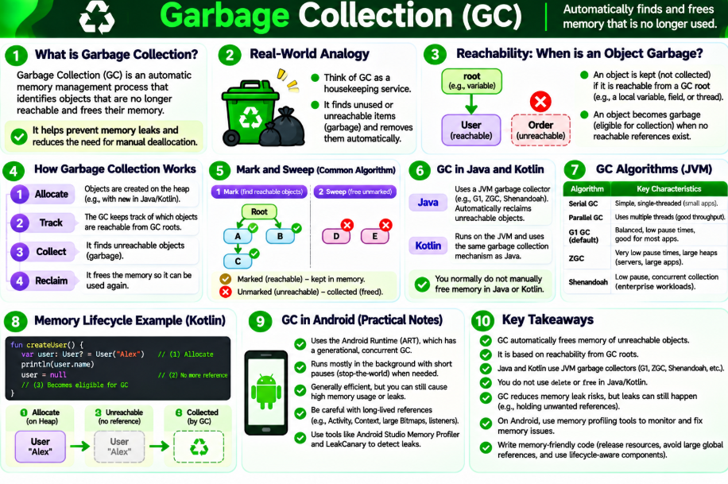

# Garbage Collection



## 1. What is Garbage Collection?

Garbage Collection (GC) is an automatic memory
management mechanism that identifies unreachable
objects and reclaims their memory.

### Real-World Analogy

Imagine a cleaner working in your house.

- You purchase things (Memory Allocation).
- You use those things (Memory Usage).
- You throw away unwanted things.
- The cleaner removes the garbage (Garbage Collection).

The Garbage Collector works similarly inside a program.

## 2. Why Do We Need Garbage Collection?

Without proper memory management, unused objects
could continue occupying memory.

Garbage Collection helps:

- Reclaim unused memory.
- Reduce manual memory management.
- Prevent certain memory-related errors.
- Make application development easier.

## 3. How Does Garbage Collection Work?

Consider this Kotlin example:

```kotlin
data class User(val name: String)

var user: User? = User("Alex")

user = null
```

Before:

```text
user ------> User("Alex")
```

After assigning null:

```text
user ------> null

             User("Alex")
             No remaining references
                    |
                    v
             Eligible for GC
```

The Garbage Collector can reclaim the object's memory
when it determines that the object is unreachable.

This does not necessarily happen immediately.

## 4. Reachable vs Unreachable Objects

```kotlin
var user1: User? = User("Alex")
var user2: User? = user1

user1 = null
```

Memory representation:

```text
user1 ------> null

user2 ------> User("Alex")
```

The object cannot be garbage-collected yet
because user2 still references it.

```kotlin
user2 = null
```

Now the object becomes eligible for garbage collection,
assuming no other reachable references exist.

## 5. Garbage Collection Roots (GC Roots)

GC Roots are starting points used by the
Garbage Collector to find reachable objects.

Common examples include:

- References in active function calls.
- Static fields.
- References held by active threads.
- Certain native references.

```text
GC Root
   |
   v
Object A -----> Object B -----> Object C

Object D -----> Object E
```

Objects A, B and C are reachable.

Objects D and E are unreachable and can
be garbage-collected.

## 6. Common Garbage Collection Algorithms

### Mark and Sweep

Works in two main steps:

1. Mark all reachable objects.
2. Reclaim memory occupied by unmarked objects.

```text
Before GC:

[A] [B] [C] [D] [E]

After marking:

[A] [B] [X] [D] [X]

After sweeping:

[A] [B] [ ] [D] [ ]
```

C and E were unreachable, so their memory
was reclaimed.

### Mark and Compact

Similar to Mark and Sweep, but also moves
surviving objects together to reduce fragmentation.

```text
Before compaction:

[A] [ ] [B] [ ] [C]

After compaction:

[A] [B] [C] [ ] [ ]
```

### Copying Collection

Copies surviving objects into another memory
region and reclaims the old region.

### Generational Garbage Collection

Groups objects based on how long they have survived.

- Young Generation: Recently allocated objects.
- Old Generation: Objects that have survived longer.

The idea is that many newly created objects
become unreachable quickly.

Not every Garbage Collector uses these algorithms
or memory regions in the same way.

## 7. Garbage Collection in Different Languages

| Language | Memory Management |
|---|---|
| Java | Automatic Garbage Collection |
| Kotlin/JVM | Automatic Garbage Collection |
| Python | Reference counting and cyclic GC in CPython |
| JavaScript | Automatic Garbage Collection |
| C | Manual memory management |
| C++ | Ownership, RAII and manual memory management |
| Rust | Ownership and borrowing |

## 8. Java vs C++

### Java — Automatic

```java
User user = new User();

user = null;

// Eligible for GC if unreachable
```

### C++ — Manual

```cpp
int* ptr = new int(10);

delete ptr;
ptr = nullptr;
```

Modern C++ also supports automatic lifetime
management using smart pointers.

```cpp
auto ptr = std::make_unique<int>(10);

// Automatically released when its owner is destroyed
```

## 9. Can Memory Leaks Still Happen?

Yes!

Garbage Collection cannot determine whether
your application still needs a reachable object.

### Android Example

```kotlin
object AppManager {
    var activity: Activity? = null
}
```

If AppManager retains a destroyed Activity,
the Activity may remain reachable unnecessarily.

This is a memory leak.

The Garbage Collector sees the reference
and therefore cannot reclaim the Activity.

## 10. Can We Force Garbage Collection?

Java and Kotlin/JVM allow us to request GC.

```kotlin
System.gc()
```

However, this is only a request.

It does not guarantee that Garbage Collection
will run immediately.

Generally, let the runtime manage GC automatically.

## 11. Disadvantages of Garbage Collection

- Consumes some CPU resources.
- May temporarily pause application execution.
- Can introduce performance overhead.
- Does not prevent all memory leaks.
- Does not guarantee immediate memory reclamation.

Frequent object allocation can increase GC activity
and contribute to Android UI performance problems.

## 12. Key Takeaways

- Garbage Collection automatically reclaims
  memory occupied by unreachable objects.
- Reachable objects cannot normally be collected.
- Setting a variable to null does not immediately
  destroy its object.
- Java and Kotlin/JVM use Garbage Collection.
- C++ primarily uses ownership and RAII.
- Memory leaks are possible even with GC.
- Garbage Collection manages memory, not all
  external resources such as files and sockets.