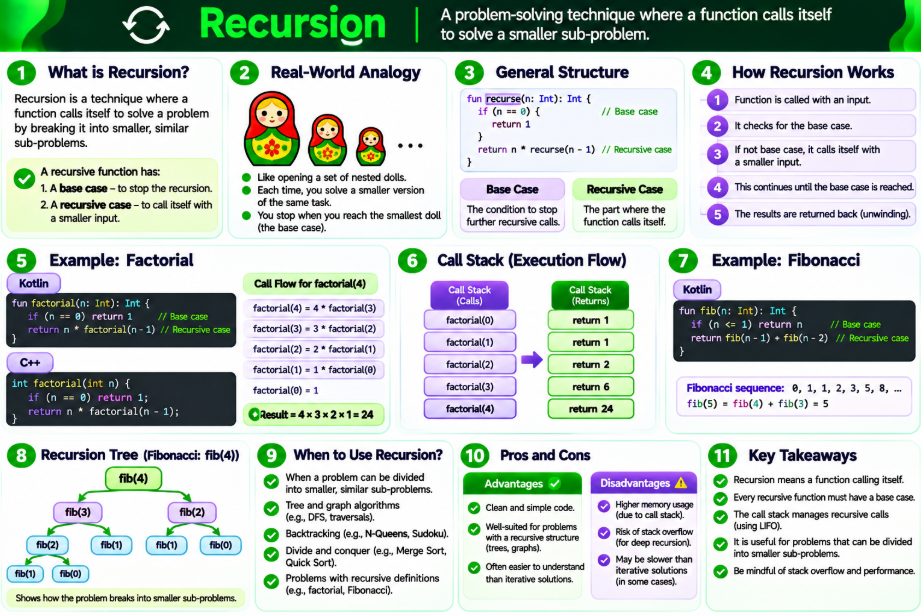

# Recursion



## 1. What is Recursion?

Recursion occurs when a function calls itself
to solve a smaller version of the same problem.

### Real-World Analogy

Imagine opening a box that contains a smaller box.
Inside that smaller box is another box.

You keep opening boxes until you find an empty one.

- Opening another box = Recursive call.
- Finding an empty box = Base case.

## 2. Two Important Parts of Recursion

Every terminating recursive solution needs:

- **Base Case:** The condition that stops recursion.
- **Recursive Case:** The function calls itself
  with a smaller or simpler problem.

```kotlin
fun countdown(n: Int) {

    // Base case
    if (n <= 0) return

    println(n)

    // Recursive case
    countdown(n - 1)
}

countdown(5)
```

Output:

```text
5
4
3
2
1
```

Without a reachable base case, recursion can
continue until the call stack runs out of space.

---

## 3. How Recursion Works Internally

Every ordinary recursive function call creates
a new stack frame on the call stack.

```kotlin
fun countdown(n: Int) {
    if (n <= 0) return

    println(n)
    countdown(n - 1)
}

countdown(3)
```

Execution flow:

```text
countdown(3) → Prints 3
    |
    v
countdown(2) → Prints 2
    |
    v
countdown(1) → Prints 1
    |
    v
countdown(0) → Base case reached
```

Call stack at the deepest point:

```text
+----------------+
| countdown(0)   | <-- Top
+----------------+
| countdown(1)   |
+----------------+
| countdown(2)   |
+----------------+
| countdown(3)   |
+----------------+
```

After reaching the base case, the functions
return in reverse order.

```text
countdown(0) returns
countdown(1) returns
countdown(2) returns
countdown(3) returns
```

This process is called Stack Unwinding.

## 4. Factorial Using Recursion

Factorial means multiplying a positive integer
by every positive integer smaller than it.

```text
5! = 5 × 4 × 3 × 2 × 1 = 120
```

By definition, 0! = 1.

### Kotlin

```kotlin
fun factorial(n: Int): Int {
    require(n >= 0)

    if (n <= 1) return 1

    return n * factorial(n - 1)
}

println(factorial(5)) // 120
```

### Java

```java
static int factorial(int n) {
    if (n < 0)
        throw new IllegalArgumentException();

    if (n <= 1)
        return 1;

    return n * factorial(n - 1);
}
```

### C++

```cpp
#include <stdexcept>

int factorial(int n) {
    if (n < 0)
        throw std::invalid_argument("Negative number");

    if (n <= 1)
        return 1;

    return n * factorial(n - 1);
}
```

These examples use integers and are intended
for small inputs because factorials grow rapidly.

### Step-by-Step Execution

Going down:

```text
factorial(5)
= 5 × factorial(4)
= 5 × 4 × factorial(3)
= 5 × 4 × 3 × factorial(2)
= 5 × 4 × 3 × 2 × factorial(1)
```

Returning back:

```text
factorial(1) = 1
factorial(2) = 2 × 1  = 2
factorial(3) = 3 × 2  = 6
factorial(4) = 4 × 6  = 24
factorial(5) = 5 × 24 = 120
```

## 5. Code Before vs After the Recursive Call

This is important for understanding recursion.

### Print Before the Recursive Call

```kotlin
fun printNumbers(n: Int) {
    if (n == 0) return

    print("$n ")
    printNumbers(n - 1)
}

printNumbers(3)
```

Output:

```text
3 2 1
```

### Print After the Recursive Call

```kotlin
fun printNumbers(n: Int) {
    if (n == 0) return

    printNumbers(n - 1)
    print("$n ")
}

printNumbers(3)
```

Output:

```text
1 2 3
```

These examples assume a non-negative input.

Code before the recursive call executes while
the stack is growing.

Code after the recursive call executes while
the stack is unwinding.

## 6. Types of Recursion

### Direct Recursion

A function calls itself directly.

```kotlin
fun count(n: Int) {
    if (n <= 0) return

    count(n - 1)
}
```

### Indirect Recursion

Two or more functions call each other.

```kotlin
fun functionA(n: Int) {
    if (n <= 0) return

    functionB(n - 1)
}

fun functionB(n: Int) {
    if (n <= 0) return

    functionA(n - 1)
}
```

### Tail Recursion

The recursive call is the final operation
performed by the function.

```kotlin
tailrec fun sum(
    n: Int,
    result: Int = 0
): Int {
    if (n <= 0) return result

    return sum(n - 1, result + n)
}

println(sum(5)) // 15
```

Kotlin's tailrec keyword allows the compiler
to optimize eligible recursion into a loop,
avoiding additional recursive stack frames.

### Multiple / Tree Recursion

A function calls itself multiple times.

```kotlin
fun fibonacci(n: Int): Int {
    require(n >= 0)

    if (n <= 1) return n

    return fibonacci(n - 1) + fibonacci(n - 2)
}

println(fibonacci(5)) // 5
```

Execution tree:

```text
           fib(4)
          /      \
       fib(3)    fib(2)
       /   \      /   \
    fib(2) fib(1) fib(1) fib(0)
    /   \
 fib(1) fib(0)
```

Notice that some calculations are repeated.

This can be improved using Memoization
or Dynamic Programming.

## 7. Recursion vs Iteration

### Using Recursion

```kotlin
fun count(n: Int) {
    if (n <= 0) return

    println(n)
    count(n - 1)
}
```

### Using Iteration

```kotlin
for (i in 5 downTo 1) {
    println(i)
}
```

| Recursion | Iteration |
|---|---|
| Uses function calls | Uses loops |
| Stops using a base case | Stops using loop conditions |
| Usually requires call stack space | Often requires less memory |
| Useful for recursive structures | Useful for simple repetition |
| May cause stack overflow | May cause infinite loops |

## 8. Real-World Example: Linked List

Recursion can visit every node in a linked list.

```cpp
struct Node {
    int data;
    Node* next;
};

void printList(Node* head) {

    // Base case
    if (head == nullptr)
        return;

    std::cout << head->data << " ";

    // Recursive case
    printList(head->next);
}
```

Visualization:

```text
[10] ---> [20] ---> [30] ---> nullptr

printList(10)
    printList(20)
        printList(30)
            printList(nullptr)
                STOP
```

Output:

```text
10 20 30
```

## 9. Real-World Uses of Recursion

- Linked list traversal
- Binary tree traversal
- Graph traversal with visited-node tracking
- Binary search
- Merge sort and quicksort
- Directory and folder traversal
- Backtracking
- Parsing nested JSON structures

Recursion is particularly useful when a problem
contains smaller versions of itself.

## 10. Time and Space Complexity

| Example | Time | Auxiliary Space |
|---|---|---|
| Recursive countdown | O(n) | O(n) |
| Recursive factorial | O(n) | O(n) |
| Recursive binary search | O(log n) | O(log n) |
| Naive recursive Fibonacci | O(2^n) upper bound | O(n) |
| Optimized tail-recursive sum | O(n) | O(1) |

These assume ordinary constant-time numeric
operations and no additional compiler optimization,
except for the tail-recursive example.

## 11. Common Mistakes

### Missing Base Case

```kotlin
fun count(n: Int) {
    count(n - 1)
}
```

Eventually causes a StackOverflowError
on Kotlin/JVM.

### Not Moving Toward the Base Case

```kotlin
fun count(n: Int) {
    if (n == 0) return

    count(n)
}
```

The value of n never changes.

Correct:

```kotlin
count(n - 1)
```

### Using Recursion Unnecessarily

For simple repetition, a loop is often
more straightforward and memory-efficient.

## 12. Interview Questions

**Q: What is recursion?**

A technique where a function calls itself
to solve smaller or simpler problems.

**Q: What is a base case?**

A condition that stops recursive calls.

**Q: What is stack unwinding?**

The process of returning from function calls
in reverse order.

**Q: What is tail recursion?**

Recursion where the recursive call is
the final operation.

**Q: Is recursion always better than iteration?**

No. Recursion can require additional memory
and function call overhead.

## 13. Key Takeaways

- Recursion = a function calling itself.
- Base case = stopping condition.
- Recursive case = solving a smaller problem.
- Recursive calls normally use the call stack.
- Stack unwinding happens when functions return.
- Missing or unreachable base cases can cause
  stack overflow.
- Recursion is useful for trees, linked lists
  and divide-and-conquer algorithms.