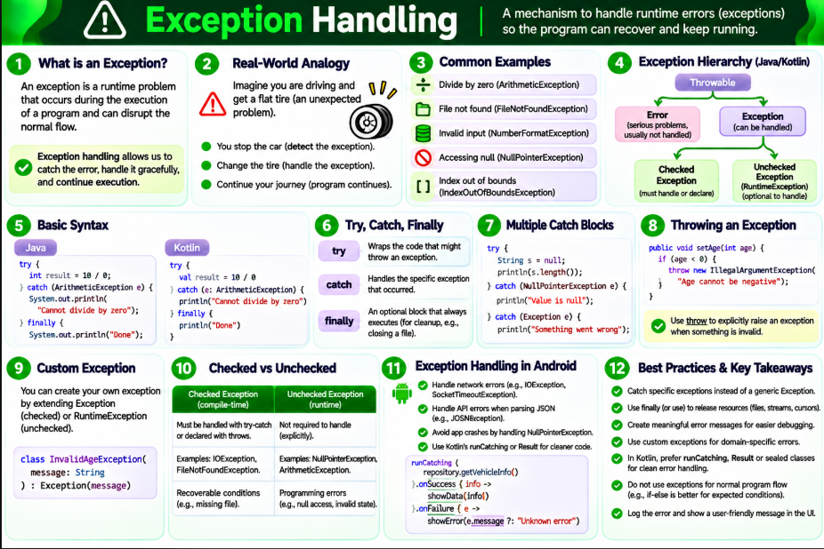

# Exception and Error Handling



## 1. What is Exception Handling?

Exception handling is a mechanism that allows
a program to handle unexpected problems during
execution instead of crashing unnecessarily.

### Real-World Analogy

Imagine driving a car and getting a flat tire.

Instead of abandoning the journey, you:

- Stop the car.
- Replace the damaged tire.
- Continue your journey.

Exception handling works in a similar way.

---

## 2. Types of Programming Errors

| Error Type | Meaning | Example |
|---|---|---|
| Syntax Error | Invalid programming syntax | Missing bracket |
| Runtime Error | Problem during execution | Division by zero |
| Logical Error | Program produces incorrect results | Incorrect formula |

### Syntax Error

```kotlin
val number = // Compilation error
```

### Runtime Error

```kotlin
val divisor = 0
val result = 10 / divisor

// ArithmeticException on Kotlin/JVM
```

### Logical Error

```kotlin
val length = 10
val width = 5

val area = length + width // Incorrect
```

The program runs, but the result is wrong.
The correct calculation is length * width.

---

## 3. What is an Exception?

An exception is an event that interrupts
the normal execution of a program.

Common examples include:

- Dividing an integer by zero.
- Accessing an invalid array index.
- Opening a missing file.
- Converting invalid text into a number.
- Network request failures.
- Accessing a null reference.

---

## 4. Try, Catch and Finally

| Keyword | Purpose |
|---|---|
| try | Contains code that might throw an exception |
| catch | Handles a matching exception |
| finally | Normally executes whether an exception occurs or not |
| throw | Explicitly throws an exception |
| throws | Declares possible exceptions in Java |

### Try-Catch

```kotlin
try {
    val number = "Hello".toInt()
    println(number)
} catch (e: NumberFormatException) {
    println("Invalid number")
}
```

Output:

```text
Invalid number
```

Instead of allowing the exception to terminate
execution, we handle it inside the catch block.

---

## 5. Finally Block

The finally block normally executes regardless
of whether an exception occurs.

```kotlin
try {
    val number = "Hello".toInt()
} catch (e: NumberFormatException) {
    println("Invalid number")
} finally {
    println("Operation completed")
}
```

Output:

```text
Invalid number
Operation completed
```

Finally is useful for cleanup operations,
such as closing files or releasing resources.

It is not guaranteed to run if the process
is forcibly terminated.

---

## 6. Multiple Catch Blocks

Different exceptions can be handled differently.

```kotlin
try {
    val numbers = intArrayOf(10, 20, 30)
    println(numbers[5])
} catch (e: ArithmeticException) {
    println("Calculation error")
} catch (e: IndexOutOfBoundsException) {
    println("Invalid array index")
} catch (e: Exception) {
    println("Something went wrong")
}
```

Output:

```text
Invalid array index
```

Always place specific exception handlers
before more general exception handlers.

---

## 7. Throwing an Exception

The throw keyword allows us to deliberately
raise an exception when something is invalid.

```kotlin
fun validateAge(age: Int) {
    if (age < 0) {
        throw IllegalArgumentException(
            "Age cannot be negative"
        )
    }
}

validateAge(-5)
```

Kotlin also provides a shorter approach:

```kotlin
fun validateAge(age: Int) {
    require(age >= 0) {
        "Age cannot be negative"
    }
}
```

---

## 8. Checked vs Unchecked Exceptions

### Checked Exceptions

Java requires the programmer to either handle
checked exceptions or declare them using throws.

```java
import java.io.*;

void readFile() throws IOException {
    try (FileReader reader = new FileReader("data.txt")) {
        reader.read();
    }
}
```

### Unchecked Exceptions

The Java compiler does not require these
exceptions to be caught or declared.

```java
String text = null;

text.length(); // NullPointerException
```

| Checked Exceptions | Unchecked Exceptions |
|---|---|
| Handling or declaration required in Java | Not required by Java compiler |
| IOException | NullPointerException |
| SQLException | ArithmeticException |

Kotlin does not enforce Java-style checked
exception handling.

---

## 9. Common Exceptions

| Exception | Cause |
|---|---|
| NullPointerException | Accessing a null reference |
| ArithmeticException | Invalid arithmetic, such as integer division by zero |
| IndexOutOfBoundsException | Invalid index |
| NumberFormatException | Invalid numeric text |
| IllegalArgumentException | Invalid function argument |
| IllegalStateException | Operation performed in an invalid state |
| IOException | Input/output failure |
| FileNotFoundException | File cannot be opened |
| SecurityException | Security or permission violation |

---

## 10. Exception Handling in Different Languages

### Kotlin

```kotlin
try {
    println("abc".toInt())
} catch (e: NumberFormatException) {
    println("Invalid number")
}
```

### Java

```java
try {
    Integer.parseInt("abc");
} catch (NumberFormatException e) {
    System.out.println("Invalid number");
}
```

### C++

```cpp
try {
    throw std::runtime_error("Something went wrong");
} catch (const std::exception& e) {
    std::cout << e.what();
}
```

### Python

```python
try:
    number = int("abc")
except ValueError:
    print("Invalid number")
```

---

## 11. Exception Propagation

If a function does not handle an exception,
the exception normally propagates to its caller.

```kotlin
fun functionC() {
    throw IllegalStateException("Error")
}

fun functionB() {
    functionC()
}

fun functionA() {
    try {
        functionB()
    } catch (e: IllegalStateException) {
        println("Exception handled")
    }
}

functionA()
```

Execution flow:

```text
functionA()
    |
    v
functionB()
    |
    v
functionC()
    |
    Exception thrown
    |
    v
functionB()  (No handler)
    |
    v
functionA()  (Exception handled)
```

The exception travels back through the call stack
until a matching exception handler is found.

---

## 12. Exception vs Error

In Java and Kotlin/JVM, Throwable is the
parent class of Exception and Error.

```text
             Throwable
             /       \
       Exception     Error
          |            |
   IOException    OutOfMemoryError
   RuntimeException   StackOverflowError
          |
   NullPointerException
```

| Exception | Error |
|---|---|
| Often represents a condition that can be handled | Often represents a serious runtime problem |
| IOException | OutOfMemoryError |
| NumberFormatException | StackOverflowError |

Applications generally should not try to recover
from serious JVM Errors indiscriminately.

---

## 13. Custom Exceptions

We can create our own exception classes
for application-specific problems.

```kotlin
class InsufficientBalanceException(message: String)
    : Exception(message)

fun withdraw(balance: Int, amount: Int) {
    if (amount > balance) {
        throw InsufficientBalanceException(
            "Insufficient balance"
        )
    }
}
```

Custom exceptions help communicate specific
problems in business logic.

---

## 14. Try as an Expression in Kotlin

In Kotlin, try-catch can also return a value.

```kotlin
val number = try {
    "abc".toInt()
} catch (e: NumberFormatException) {
    0
}

println(number) // 0
```

For simple numeric conversion, a cleaner
alternative is:

```kotlin
val number = "abc".toIntOrNull() ?: 0
```

---

## 15. Real-World Android Example

Imagine requesting vehicle information from an API.

```kotlin
suspend fun loadVehicle() {
    try {
        val vehicle = repository.getVehicle()

        println(vehicle)

    } catch (e: IOException) {
        println("Network error. Please try again.")
    } finally {
        println("Request finished")
    }
}
```

Instead of crashing when the network fails,
the application can display an error message.

In Kotlin coroutines, avoid swallowing
CancellationException because it is used
to cancel coroutine execution.

---

## 16. Best Practices

- Catch specific exceptions.
- Provide meaningful error messages.
- Never silently ignore important exceptions.
- Validate inputs before performing operations.
- Do not use exceptions for normal control flow.
- Release resources properly.
- Avoid catching Throwable unnecessarily.
- Never expose passwords or sensitive data in logs.

### Bad Practice

```kotlin
try {
    performOperation()
} catch (e: Exception) {
    // Ignoring the problem
}
```

### Better Practice

```kotlin
try {
    performOperation()
} catch (e: IOException) {
    Log.e("Operation", "Operation failed", e)
}
```

---

## 17. Key Takeaways

- Exception = an interruption in normal execution.
- try = attempt an operation.
- catch = handle an exception.
- finally = perform cleanup.
- throw = raise an exception.
- throws = declare possible exceptions in Java.
- Unhandled exceptions propagate through the call stack.
- Kotlin does not enforce checked exceptions.
- Exception handling makes applications more reliable.