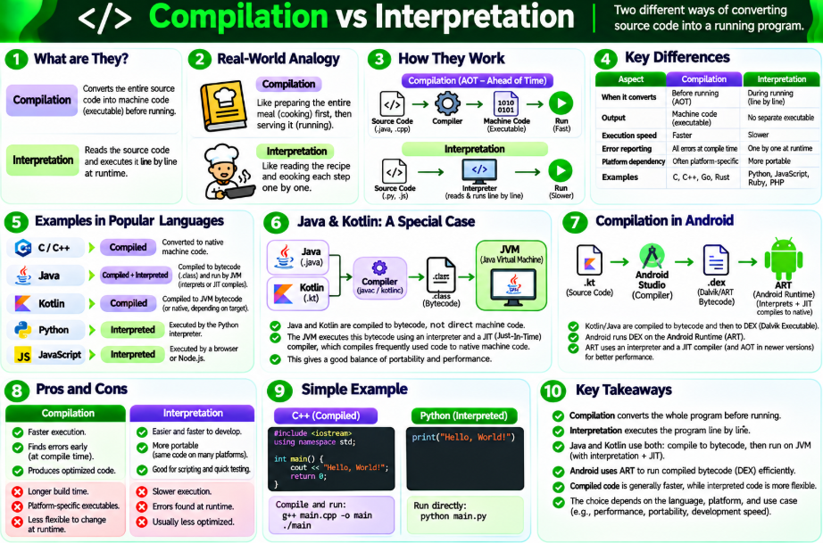

# Compilation vs Interpretation



## 1. What is Compilation and Interpretation?

Computers cannot directly understand most
high-level programming languages.

Our source code must be translated into a
form that the computer can execute.

Two common approaches are:

- **Compilation:** Translate code into another
  executable form before running it.
- **Interpretation:** Execute code through an
  interpreter at runtime.

Many modern languages use a combination of both.

## 2. Real-World Analogy

Imagine reading a book written in Japanese
when you only understand English.

### Compilation

A translator translates the entire book into
English before giving it to you.

You can then read the translated book repeatedly.

### Interpretation

A translator sits beside you and translates
the book as you read it.

Translation happens while you are reading.

---

## 3. How Compilation Works

```text
Source Code
     |
     v
  Compiler
     |
     v
 Machine Code
     |
     v
  Execution
     |
     v
   Output
```

### C++ Example

```cpp
#include <iostream>

int main() {
    std::cout << "Hello World";
    return 0;
}
```

Compile the program:

```bash
g++ main.cpp -o main
```

Execute the compiled program:

```bash
./main
```

Output:

```text
Hello World
```

The compiler translates the C++ code into
machine code that the processor can execute.

## 4. How Interpretation Works

```text
Source Code
     |
     v
 Interpreter
     |
     v
  Execution
     |
     v
   Output
```

### Python Example

```python
print("Hello World")
```

Run the program:

```bash
python main.py
```

Output:

```text
Hello World
```

The Python runtime handles the execution.

In CPython, source code is first compiled
into bytecode, which is then interpreted.

Interpreters do not necessarily execute
source code directly, line by line.

## 5. Compiler vs Interpreter

| Compiler | Interpreter |
|---|---|
| Translates code into another representation | Executes code through a runtime |
| Can generate machine code or bytecode | Can execute source code or bytecode |
| Native compiled code is often faster | Interpretation may introduce overhead |
| May generate executable files | Usually requires an interpreter |
| Example: C++ compiler | Example: CPython interpreter |

## 6. What is Machine Code?

Machine code consists of instructions that
a processor can execute directly.

It is represented using binary data.

```text
10110000 01100001
```

Different processor architectures can use
different machine instructions.

Examples:

- ARM
- x86
- x86-64

## 7. What is Bytecode?

Bytecode is an intermediate representation
between source code and machine code.

It is generally designed to be executed
by a virtual machine or runtime.

```text
Source Code
     |
     v
  Compiler
     |
     v
  Bytecode
     |
     v
Virtual Machine
     |
     v
  Execution
```

Java, Kotlin/JVM and Python implementations
such as CPython use bytecode.

## 8. How Java Executes Code

Java uses a combination of compilation
and runtime execution.

```text
Java Source Code (.java)
          |
          v
    Java Compiler (javac)
          |
          v
     Bytecode (.class)
          |
          v
  Java Virtual Machine (JVM)
          |
          v
       Execution
```

The JVM may interpret bytecode or compile
it into native machine code during execution.

This allows Java bytecode to run on different
platforms with compatible JVM implementations.

## 9. AOT vs JIT Compilation

### AOT (Ahead-of-Time Compilation)

Code is compiled into native machine code
before the relevant execution.

Example: A typical C++ executable.

### JIT (Just-in-Time Compilation)

Code is compiled into native machine code
during program execution.

Frequently executed code can be optimized
by the runtime.

Example: JVM JIT compiler.

| AOT | JIT |
|---|---|
| Compiles before execution | Compiles during execution |
| Can reduce runtime compilation overhead | Can optimize using runtime information |
| Typical C++ compilation | JVM runtime compilation |

## 10. How Kotlin Android Executes Code

Android applications use ART (Android Runtime).

The simplified build process is:

```text
Kotlin Source Code (.kt)
          |
          v
    Kotlin Compiler
          |
          v
    JVM Bytecode (.class)
          |
          v
       D8 / R8
          |
          v
    DEX Bytecode (.dex)
          |
          v
    APK / App Bundle
          |
          v
    Android Runtime (ART)
          |
          v
       Execution
```

ART uses a combination of:

- Interpretation
- JIT Compilation
- AOT Compilation

This helps balance application performance,
startup time and memory usage.

## 11. Programming Languages Comparison

| Language | Typical Execution Approach |
|---|---|
| C | Native compilation |
| C++ | Native compilation |
| Rust | Native compilation |
| Go | Native compilation |
| Java | Bytecode + JVM interpretation/JIT |
| Kotlin/JVM | Bytecode + JVM interpretation/JIT |
| Kotlin Android | DEX bytecode + ART |
| Python (CPython) | Bytecode interpretation |
| JavaScript | Interpretation and/or JIT compilation |
| C# | Intermediate Language + JIT/AOT |

These are typical implementations rather than
strict requirements of the languages themselves.

## 12. Key Takeaways

- Compilation = translate code before its execution.
- Interpretation = execute code through an interpreter.
- Machine code is directly executable by a processor.
- Bytecode is an intermediate representation.
- AOT compilation happens ahead of execution.
- JIT compilation happens during execution.
- Java and Kotlin use hybrid execution approaches.
- Android uses ART to execute DEX bytecode.
- A language is not necessarily exclusively
  compiled or interpreted.