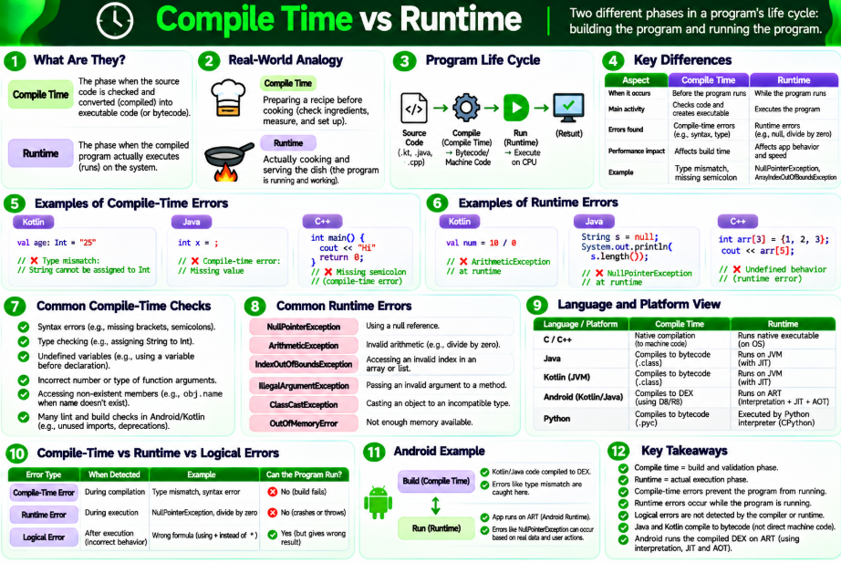

# Compile Time vs Runtime



## 1. What is Compile Time and Runtime?

- **Compile Time:** The stage when the compiler
  translates and checks your code.
- **Runtime:** The stage when your program is
  actually executing.

## 2. Real-World Analogy

Imagine building and driving a car.

- Compile Time: Building and inspecting the car
  before it leaves the factory.
- Runtime: Actually driving the car on the road.

A car might pass every factory inspection but
still experience a flat tire while driving.

Similarly, a program can compile successfully
but still fail during execution.

---

## 3. Compile Time

During compilation, the compiler can check:

- Programming syntax.
- Data type compatibility.
- Function signatures.
- Variable declarations.
- Access restrictions.

### Kotlin Example

```kotlin
val age: Int = "Twenty"
```

Output:

```text
Compilation Error: Type mismatch
```

The compiler detects that a String cannot
be assigned to an Int variable.

The program cannot be successfully compiled
until the error is fixed.

### Another Example

```kotlin
fun add(a: Int, b: Int): Int {
    return a + b
}

add(10) // Compilation error: Missing argument
```

---

## 4. Runtime

Runtime begins when the program executes.

During runtime, the program performs operations
such as:

- Reading user input.
- Making API requests.
- Creating objects.
- Allocating memory.
- Reading files.
- Performing calculations.

### Kotlin Example

```kotlin
val numbers = intArrayOf(10, 20, 30)

println(numbers[5])
```

The code compiles successfully, but accessing
index 5 causes an ArrayIndexOutOfBoundsException
during execution.

---

## 5. How They Work Together

```text
Write Source Code
        |
        v
    Compile Time
        |
        v
   Compilation Successful?
       / \
     No   Yes
     |     |
 Fix Code  v
         Runtime
           |
           v
      Program Execution
```

Successful compilation does not guarantee
successful execution.

## 6. Compile-Time vs Runtime Errors

| Compile-Time Errors | Runtime Errors |
|---|---|
| Detected during compilation | Occur during execution |
| Incorrect syntax | Invalid array index |
| Incompatible data types | NullPointerException |
| Missing function arguments | Network failure |
| Undeclared variables | OutOfMemoryError |

Logical errors are another category.

A program can compile and execute successfully
but still produce an incorrect result.

## 7. Compile-Time Constants vs Runtime Values

### Compile-Time Constant

```kotlin
const val MAX_USERS = 100
```

The value is known during compilation.

### Runtime Value

```kotlin
val currentTime = System.currentTimeMillis()
```

The value is determined when the program runs.

Although currentTime uses val, it is not
a compile-time constant.

Remember: val prevents reassignment, whereas
const val declares a compile-time constant.

## 8. Compile-Time vs Runtime Polymorphism

### Compile-Time Polymorphism (Overloading)

The compiler determines which function to call
based on its arguments and their compile-time types.

```kotlin
fun display(value: Int) {
    println("Integer: $value")
}

fun display(value: String) {
    println("String: $value")
}

display(10)
display("Hello")
```

### Runtime Polymorphism (Overriding)

The implementation is selected based on
the actual object during execution.

```kotlin
open class Animal {
    open fun sound() {
        println("Animal sound")
    }
}

class Dog : Animal() {
    override fun sound() {
        println("Bark")
    }
}

val animal: Animal = Dog()

animal.sound() // Bark
```

Although animal has the declared type Animal,
the Dog implementation is executed.

Polymorphism will be covered in a separate chapter.

## 9. Real-World Android Example

### Compile Time

```kotlin
val batteryPercentage: Int = "85"
```

The compiler rejects the incompatible type.

### Runtime

```kotlin
val batteryPercentage = "Unavailable".toInt()
```

The code compiles but throws a
NumberFormatException when executed.

### Safer Approach

```kotlin
val batteryPercentage = "Unavailable".toIntOrNull()
```

The result is null instead of an exception.

## 10. Quick Comparison

| Feature | Compile Time | Runtime |
|---|---|---|
| When | During compilation | During execution |
| Main responsibility | Translation and code checking | Executing instructions |
| Type checking | Static type checking | Runtime type checks |
| Constants | Compile-time known values | Values calculated during execution |
| Polymorphism | Overload resolution | Dynamic method dispatch |
| Common problems | Compilation errors | Exceptions and execution failures |

## 11. Key Takeaways

- Compile time = translating and checking code.
- Runtime = actually executing the program.
- Compilation success does not guarantee error-free execution.
- Not every val is a compile-time constant.
- Overloading is generally resolved at compile time.
- Overridden virtual methods are dispatched at runtime.
- Modern runtimes can also compile code during execution
  using JIT compilation.