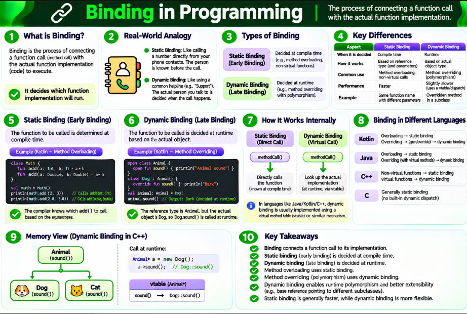

# Static vs Dynamic Binding



## 1. What is Binding?

Binding is the process of connecting a function
or method call to the implementation that will execute.

- **Static Binding:** Decided at compile time.
- **Dynamic Binding:** Decided at runtime.

Static binding is also called Early Binding.
Dynamic binding is also called Late Binding.

## 2. Real-World Analogy

Imagine ordering food at a restaurant.

- Static Binding: You choose your meal before
  arriving at the restaurant.
- Dynamic Binding: You choose your meal after
  arriving at the restaurant.

The difference is WHEN the decision is made.

## 3. Static Binding (Early Binding)

The compiler determines which function to call
before the program runs.

### Kotlin Example: Function Overloading

```kotlin
fun show(value: Int) {
    println("Integer")
}

fun show(value: String) {
    println("String")
}

show(10)      // Integer
show("Hello") // String
```

The compiler already knows which function
to call based on the argument type.

## 4. Dynamic Binding (Late Binding)

The method implementation is selected at runtime
based on the actual object.

### Kotlin Example: Method Overriding

```kotlin
open class Animal {
    open fun sound() {
        println("Animal sound")
    }
}

class Dog : Animal() {
    override fun sound() {
        println("Bark")
    }
}

class Cat : Animal() {
    override fun sound() {
        println("Meow")
    }
}
```

```kotlin
val animal1: Animal = Dog()
val animal2: Animal = Cat()

animal1.sound() // Bark
animal2.sound() // Meow
```

Both variables have the declared type Animal.

However, the actual objects are different.

At runtime, the appropriate overridden
implementation is selected.

```text
animal1 (Animal)
    |
    v
Dog Object --> sound() --> Bark

animal2 (Animal)
    |
    v
Cat Object --> sound() --> Meow
```

## 5. Static vs Dynamic Binding in C++

### Static Binding

```cpp
class Animal {
public:
    void sound() {
        cout << "Animal sound";
    }
};

class Dog : public Animal {
public:
    void sound() {
        cout << "Bark";
    }
};

Dog dog;
Animal* animal = &dog;

animal->sound(); // Animal sound
```

The method is selected using the declared
pointer type because sound() is not virtual.

### Dynamic Binding

Add the virtual keyword to the parent method.

```cpp
class Animal {
public:
    virtual void sound() {
        cout << "Animal sound";
    }
};

class Dog : public Animal {
public:
    void sound() override {
        cout << "Bark";
    }
};

Dog dog;
Animal* animal = &dog;

animal->sound(); // Bark
```

Now the method is selected based on
the actual object.

## 6. Key Differences

| Static Binding | Dynamic Binding |
|---|---|
| Early binding | Late binding |
| Decided at compile time | Decided at runtime |
| Uses compile-time type information | Uses actual object type |
| Method overloading | Virtual method overriding |
| Generally less dispatch overhead | May introduce dispatch overhead |
| Less flexible | Supports runtime polymorphism |

## 7. Real-World Android Example

Imagine an application supporting multiple
notification providers.

```kotlin
interface NotificationSender {
    fun send()
}

class EmailSender : NotificationSender {
    override fun send() {
        println("Sending Email")
    }
}

class PushSender : NotificationSender {
    override fun send() {
        println("Sending Push Notification")
    }
}
```

```kotlin
fun notifyUser(sender: NotificationSender) {
    sender.send()
}

notifyUser(EmailSender()) // Sending Email
notifyUser(PushSender())  // Sending Push Notification
```

The same function works with different
implementations without changing its code.

This concept is fundamental to:

- Polymorphism
- Interfaces
- Dependency Injection
- Loose Coupling
- Strategy Design Pattern

## 8. Key Takeaways

- Binding connects a method call to its implementation.
- Static binding is decided at compile time.
- Dynamic binding is decided at runtime.
- Overloading is generally resolved at compile time.
- Overridden virtual methods support dynamic binding.
- C++ uses virtual methods for dynamic dispatch.
- Dynamic binding makes applications more flexible.