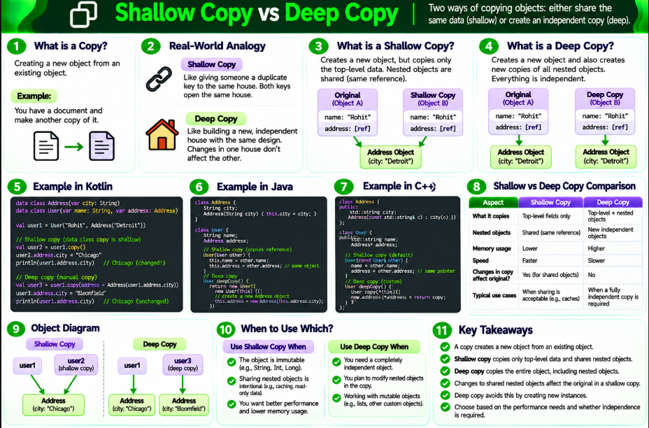

# Shallow Copy vs Deep Copy



## 1. What is Shallow Copy and Deep Copy?

When copying an object, there are two common approaches:

- **Shallow Copy:** Creates a new outer object but
  shares its nested objects with the original.
- **Deep Copy:** Creates a new object and independent
  copies of its nested mutable objects.

## 2. Real-World Analogy

Imagine two school bags containing notebooks.

- Shallow Copy: You get a new school bag,
  but you share the original notebooks.
- Deep Copy: You get a new school bag
  and your own copies of every notebook.

With a shallow copy, changing a shared notebook
affects both owners.

With a deep copy, each owner has independent notebooks.

## 3. Reference Assignment (Not a Copy)

Before understanding copying, look at this:

```kotlin
data class User(var name: String)

val user1 = User("Alex")
val user2 = user1

user2.name = "Sam"

println(user1.name) // Sam
println(user2.name) // Sam
```

Memory representation:

```text
user1 ----+
          |
          v
      [ User: Sam ]
          ^
          |
user2 ----+
```

No new object is created.
Both variables reference the same object.

## 4. Shallow Copy in Kotlin

Kotlin's data class copy() performs a shallow copy.

```kotlin
data class Address(var city: String)

data class User(
    var name: String,
    val address: Address
)

val user1 = User("Alex", Address("Mumbai"))
val user2 = user1.copy()

user2.name = "Sam"
user2.address.city = "Delhi"

println(user1.name)         // Alex
println(user2.name)         // Sam

println(user1.address.city) // Delhi
println(user2.address.city) // Delhi
```

Notice that changing the name does not affect user1,
but changing the city affects both objects.

Why? Because both users share the same Address object.

```text
user1 ---> [ User: Alex ] ----+
                             |
                             v
                       [ Address: Delhi ]
                             ^
                             |
user2 ---> [ User: Sam  ] ----+
```

## 5. Deep Copy in Kotlin

We can explicitly copy the nested Address object.

```kotlin
val user1 = User("Alex", Address("Mumbai"))

val user2 = user1.copy(
    address = user1.address.copy()
)

user2.name = "Sam"
user2.address.city = "Delhi"

println(user1.address.city) // Mumbai
println(user2.address.city) // Delhi
```

Memory representation:

```text
user1 ---> [ User: Alex ] ---> [ Address: Mumbai ]

user2 ---> [ User: Sam  ] ---> [ Address: Delhi  ]
```

Both users now have independent Address objects.

For more deeply nested mutable objects,
additional copying may be required.

## 6. Shallow Copy vs Deep Copy in Java

```java
class User {
    String name;
    Address address;

    User(String name, Address address) {
        this.name = name;
        this.address = address;
    }
}

class Address {
    String city;

    Address(String city) {
        this.city = city;
    }
}
```

### Shallow Copy

```java
User user1 = new User("Alex", new Address("Mumbai"));

User user2 = new User(user1.name, user1.address);

user2.address.city = "Delhi";

System.out.println(user1.address.city); // Delhi
```

### Deep Copy

```java
User user1 = new User("Alex", new Address("Mumbai"));

User user2 = new User(
    user1.name,
    new Address(user1.address.city)
);

user2.address.city = "Delhi";

System.out.println(user1.address.city); // Mumbai
```

## 7. Shallow Copy vs Deep Copy in C++

### Shallow Copy Using Pointers

```cpp
struct User {
    int* age;
};

int age = 25;

User user1{&age};
User user2 = user1;

*user2.age = 30;

std::cout << *user1.age; // 30
```

Both objects contain pointers to the same integer.

### Independent Copy Using Value Members

```cpp
struct User {
    int age;
};

User user1{25};
User user2 = user1;

user2.age = 30;

std::cout << user1.age; // 25
std::cout << user2.age; // 30
```

Here, each object contains its own integer value.

In C++, copying behavior depends on member types
and copy constructor implementations.

## 8. Copying Collections in Kotlin

```kotlin
data class Item(var price: Int)

val list1 = listOf(Item(100), Item(200))

val list2 = list1.toMutableList()

list2[0].price = 500

println(list1[0].price) // 500
```

The new list shares the original Item objects.

To create independent items:

```kotlin
val list3 = list1.map { it.copy() }

list3[0].price = 900

println(list1[0].price) // 500
println(list3[0].price) // 900
```

Copying a collection does not automatically
copy every object inside it.

## 9. Real-World Android Example

Imagine editing a user's profile.

```kotlin
val originalUser = User("Alex", Address("Mumbai"))

val editableUser = originalUser.copy(
    address = originalUser.address.copy()
)

editableUser.address.city = "Pune"
```

The original profile remains unchanged until
the user confirms and saves their changes.

This is useful for:

- Editing user profiles.
- Undo and redo functionality.
- Managing UI state.
- Creating independent object snapshots.
- Preserving original API response data.

## 10. Key Differences

| Feature | Shallow Copy | Deep Copy |
|---|---|---|
| New outer object | Yes | Yes |
| Nested mutable objects | Shared | Independently copied |
| Nested changes affect original | Yes | No |
| Memory usage | Generally lower | Generally higher |
| Copying speed | Generally faster | Generally slower |
| Object independence | Partial | Full for copied mutable state |

Immutable objects can generally be shared safely
without needing to duplicate them.

## 11. Interview Questions

**Q: Does Kotlin's copy() perform a deep copy?**

No. A data class copy() performs a shallow copy.

**Q: Is assigning one object variable to another
a shallow copy?**

No. In Kotlin and Java, this copies the reference,
not the object.

**Q: When should we use deep copying?**

When independently modifying nested mutable data
without affecting the original object.

## 12. Key Takeaways

- Reference assignment = same object.
- Shallow copy = new object, shared nested objects.
- Deep copy = independently copied mutable objects.
- Kotlin's copy() is shallow.
- Copying a collection does not necessarily
  copy its elements.
- Prefer immutable data when possible to reduce
  unexpected shared-state problems.