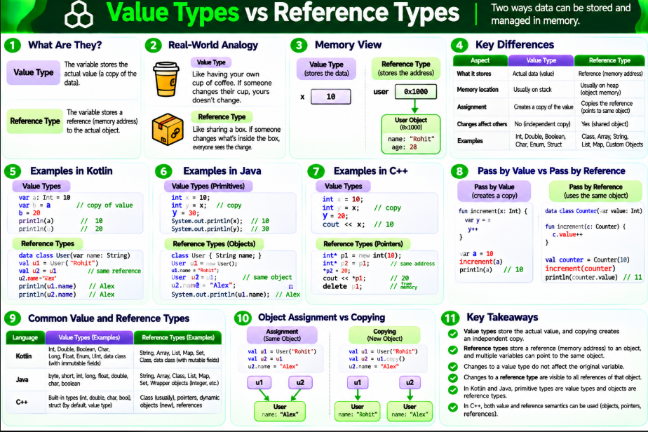

# Value Types vs Reference Types



## 1. What are Value Types and Reference Types?

- **Value Type:** Represents a value directly.
  Copying it creates an independent value.
- **Reference Type:** Refers to an object.
  Copying the reference can give two variables
  access to the same object.

## 2. Real-World Analogy

Imagine two people reading a document.

- Value Type: Both people have their own photocopy.
  Changing one copy does not affect the other.
- Reference Type: Both people access the same
  shared Google document. Changes are visible to both.

---

## 3. Value Types

Consider this Kotlin example:

```kotlin
var a = 10
var b = a

b = 20

println(a) // 10
println(b) // 20
```

Conceptual representation:

```text
Before:

a [10]
b [10]

After b = 20:

a [10]
b [20]
```

Changing b does not affect a.

Common examples of values with independent
value behavior include integers, floating-point
numbers and Booleans.

## 4. Reference Types

Consider a mutable object in Kotlin:

```kotlin
data class User(var name: String)

val user1 = User("Alex")
val user2 = user1

user2.name = "Sam"

println(user1.name) // Sam
println(user2.name) // Sam
```

Conceptual representation:

```text
user1 -----+
           |
           v
     +-------------+
     | User Object |
     | name = Sam  |
     +-------------+
           ^
           |
user2 -----+
```

Both variables refer to the same object.

Changing the object through user2 also makes
the change visible through user1.

## 5. Reassignment vs Object Modification

These are two different operations.

```kotlin
data class User(var name: String)

var user1 = User("Alex")
var user2 = user1

user2 = User("Sam")

println(user1.name) // Alex
println(user2.name) // Sam
```

Memory representation:

```text
user1 -----> [ User: Alex ]

user2 -----> [ User: Sam  ]
```

Reassigning user2 does not modify user1
or its original object.

## 6. Value Types vs Reference Types in Java

### Primitive Value

```java
int a = 10;
int b = a;

b = 20;

System.out.println(a); // 10
System.out.println(b); // 20
```

### Object Reference

```java
class User {
    String name = "Alex";
}

User user1 = new User();
User user2 = user1;

user2.name = "Sam";

System.out.println(user1.name); // Sam
```

Java has eight primitive types:

- byte
- short
- int
- long
- float
- double
- char
- boolean

Classes, arrays and interfaces are reference types.

## 7. Value Types vs References in C++

Unlike Java, C++ objects can have value semantics.

```cpp
struct User {
    int age;
};

User user1{25};
User user2 = user1;

user2.age = 30;

std::cout << user1.age; // 25
std::cout << user2.age; // 30
```

Here, user2 is a separate object.

Using a reference instead:

```cpp
User user1{25};
User& user2 = user1;

user2.age = 30;

std::cout << user1.age; // 30
```

Now user2 is another name for user1.

## 8. What About Strings?

Strings are immutable in Kotlin and Java.

```kotlin
var a = "Hello"
var b = a

b = b + " World"

println(a) // Hello
println(b) // Hello World
```

Although strings are objects on Kotlin/JVM,
their contents cannot be modified.

The operation produces a new string rather
than changing the original string.

Therefore, reference types are not
necessarily mutable.

## 9. Stack vs Heap

A simplified JVM memory representation:

```text
       STACK                    HEAP
+------------------+     +----------------+
| age = 25         |     | User Object    |
| user reference --+---> | name = "Alex"  |
+------------------+     +----------------+
```

However, value types are NOT always stored
on the stack, and objects are NOT universally
required to be stored on the heap.

For example, an integer field inside an object
can be stored as part of that heap object.

Actual memory placement depends on the
language, compiler and runtime.

## 10. Boxing and Unboxing

Boxing converts a primitive representation
into an object representation.

Unboxing performs the reverse operation.

### Java Example

```java
int number = 10;

Integer boxed = number; // Autoboxing

int value = boxed;      // Unboxing
```

Kotlin/JVM can also use boxed representations,
for example when working with nullable integers
or generic collections.

```kotlin
val number: Int = 10
val nullableNumber: Int? = 10

val numbers = listOf(10, 20, 30)
```

## 11. Real-World Android Example

Imagine two screens sharing a mutable vehicle object.

```kotlin
data class Vehicle(var speed: Int)

val dashboardVehicle = Vehicle(50)
val settingsVehicle = dashboardVehicle

settingsVehicle.speed = 80

println(dashboardVehicle.speed) // 80
```

Both screens reference the same object.

For independent state:

```kotlin
val dashboardVehicle = Vehicle(50)
val settingsVehicle = dashboardVehicle.copy()

settingsVehicle.speed = 80

println(dashboardVehicle.speed) // 50
```

Remember that Kotlin's data class copy()
performs a shallow copy.

## 12. Key Differences

| Value Semantics | Reference Semantics |
|---|---|
| Copies produce independent values | Reference copies can share objects |
| Changing a copy does not affect the original | Object modifications may affect both |
| Useful for independent data | Useful for shared objects |
| Example: C++ int | Example: Java object reference |

## 13. Common Misconceptions

- Reference types are always mutable: False.
- Value types are always stored on the stack: False.
- Copying a reference copies the entire object: False.
- Java passes objects by reference: False.
  Java passes object references by value.
- Kotlin data classes automatically have
  independent value semantics: False.

## 14. Key Takeaways

- Value semantics = independent values.
- Reference semantics = shared object access.
- Copying a reference does not copy the object.
- Reassignment and object modification are different.
- Reference types can be immutable.
- Memory placement is a separate concept.
- Type behavior varies across programming languages.