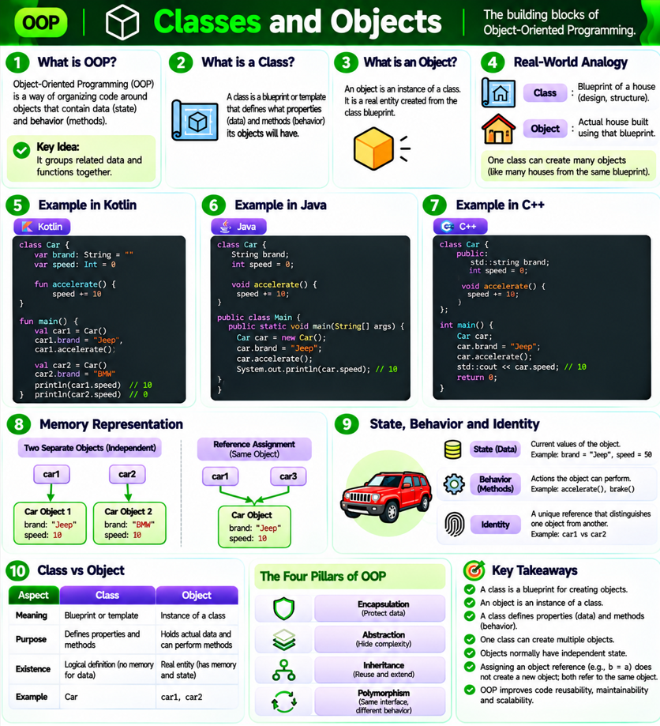

# Classes and Objects



## 1. What is a Class?

A class is a blueprint or template used to create objects.

It defines:

- Properties: What an object has (data).
- Methods: What an object can do (behavior).

For example, a Car class can define its brand,
color, speed and actions like accelerating or braking.

## 2. What is an Object?

An object is an actual instance of a class.

A single class can be used to create multiple objects,
each with its own data.

## 3. Real-World Analogy

Imagine a blueprint of a house.

- Class: The blueprint of the house.
- Object: An actual house built using that blueprint.

Using the same blueprint, we can build multiple houses.
Each house can have a different color and owner.

Similarly, one class can create multiple objects.

## 4. Classes and Objects in Kotlin

```kotlin
class Car {

    var brand = ""
    var speed = 0

    fun accelerate() {
        speed += 10
    }

    fun brake() {
        speed = 0
    }
}
```

Here:

- Car is the class.
- brand and speed are properties.
- accelerate() and brake() are methods.

### Creating Objects

```kotlin
val car1 = Car()
val car2 = Car()

car1.brand = "Jeep"
car2.brand = "BMW"

car1.accelerate()

println(car1.speed) // 10
println(car2.speed) // 0
```

Both objects are created from the same class,
but each has its own state.

## 5. Visual Representation

```text
              Class: Car
        +-------------------+
        | brand             |
        | speed             |
        | accelerate()      |
        | brake()           |
        +-------------------+
                  |
         +--------+--------+
         |                 |
         v                 v

      Object 1          Object 2
   +-------------+   +-------------+
   | brand: Jeep |   | brand: BMW  |
   | speed: 10   |   | speed: 0    |
   +-------------+   +-------------+
```

## 6. State, Behavior and Identity

An ordinary object has three characteristics.

| Characteristic | Meaning | Example |
|---|---|---|
| State | Current data | speed = 10 |
| Behavior | Actions it performs | accelerate() |
| Identity | Which specific object it is | car1 or car2 |

Two objects can have identical data but still
be different objects.

## 7. Classes and Objects in Java

```java
class Car {

    String brand;
    int speed = 0;

    void accelerate() {
        speed += 10;
    }
}
```

Creating an object:

```java
Car car = new Car();

car.brand = "Jeep";
car.accelerate();

System.out.println(car.speed); // 10
```

## 8. Classes and Objects in C++

```cpp
#include <iostream>
#include <string>

class Car {
public:
    std::string brand;
    int speed = 0;

    void accelerate() {
        speed += 10;
    }
};

int main() {
    Car car;

    car.brand = "Jeep";
    car.accelerate();

    std::cout << car.speed; // 10
}
```

Unlike Java, C++ does not require the new keyword
to create every object.

## 9. Object Creation vs Reference Assignment

```kotlin
val car1 = Car()
val car2 = Car()
```

Two separate objects are created.

```text
car1 ------> [ Car Object 1 ]

car2 ------> [ Car Object 2 ]
```

However:

```kotlin
val car3 = car1
```

No new object is created.

```text
car1 -----+
          |
          v
      [ Car Object 1 ]
          ^
          |
car3 -----+
```

Both variables refer to the same object.

```kotlin
car3.speed = 100

println(car1.speed) // 100
```

This is called reference assignment.

## 10. Class vs Object

| Class | Object |
|---|---|
| Blueprint | Actual instance |
| Defines properties | Holds actual instance data |
| Defines methods | Can execute methods |
| Describes a type | Represents a specific instance |
| Car | car1, car2 |

## 11. Real-World Android Example

Imagine a connected vehicle application.

```kotlin
class Vehicle(
    val vin: String,
    val brand: String,
    var batteryPercentage: Int
) {

    fun isBatteryLow(): Boolean {
        return batteryPercentage < 20
    }
}
```

Creating different vehicle objects:

```kotlin
val jeep = Vehicle("VIN001", "Jeep", 85)
val fiat = Vehicle("VIN002", "Fiat", 15)

println(jeep.isBatteryLow()) // false
println(fiat.isBatteryLow()) // true
```

Instead of creating separate classes for every vehicle,
we reuse the same class with different data.

## 12. Why Do We Need Classes and Objects?

- Organize related data and behavior together.
- Reuse code.
- Represent real-world entities.
- Make large applications easier to maintain.
- Provide a foundation for OOP principles.

## 13. Key Takeaways

- Class = Blueprint.
- Object = Instance of a class.
- Property = Data.
- Method = Behavior.
- One class can create multiple objects.
- Separate objects can have different states.
- Copying an object reference does not create
  a new object in Kotlin or Java.