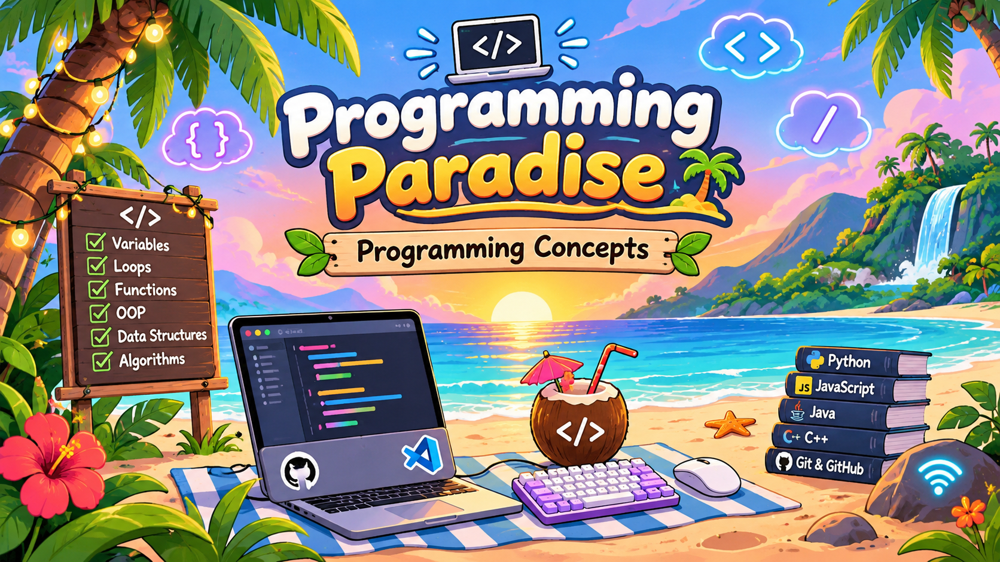

# 🌴 Programming Paradise

<p align="center">
  
</p>

<p align="center">
  <b>A personal knowledge repository for understanding programming concepts from basic to advanced.</b>
</p>

<p align="center">
  I created this repository to refresh and document important programming concepts in a simple way — from fundamentals like variables, loops, and functions to advanced topics like architecture, concurrency, and design patterns.
</p>

---

## 📚 About This Repository

**Programming Paradise** is a structured notes repository for learning and revising important programming concepts that are common across many languages like:

- Kotlin
- Java
- C++
- Python
- JavaScript

This repository is meant to be a **programming concept handbook** where each topic is explained in a simple and beginner-friendly style.

---

## 🗂 Repository Roadmap

- [01. Basic Programming Fundamentals](#01-basic-programming-fundamentals)
- [02. Object-Oriented Programming (OOP)](#02-object-oriented-programming-oop)
- [03. Programming Paradigms](#03-programming-paradigms)
- [04. Software Design Principles](#04-software-design-principles)
- [05. Intermediate and Advanced Programming](#05-intermediate-and-advanced-programming)
- [06. Multithreading and Concurrency](#06-multithreading-and-concurrency)
- [07. Design Patterns](#07-design-patterns)
- [08. Data Structures and Algorithms](#08-data-structures-and-algorithms)
- [09. Software Architecture](#09-software-architecture)
- [10. Software Testing and Code Quality](#10-software-testing-and-code-quality)

---

# 01. Basic Programming Fundamentals

These are concepts you should understand regardless of your programming language.

## ✅ Topics Covered

| # | Concept | File Name |
|---|---|---|
| 1 | Variables and Constants | [VariablesAndConstants.md](01-Programming-Fundamentals/01-VariablesAndConstants.md) |
| 2 | Data Types | [DataTypes.md](01-Programming-Fundamentals/02-DataTypes.md) |
| 3 | Mutable vs Immutable | [Mutability.md](01-Programming-Fundamentals/03-Mutability.md) |
| 4 | Static vs Dynamic Typing | [StaticVsDynamicTyping.md](01-Programming-Fundamentals/04-StaticVsDynamicTyping.md) |
| 5 | Strong vs Weak Typing | [StrongVsWeakTyping.md](01-Programming-Fundamentals/05-StrongVsWeakTyping.md) |
| 6 | Type Casting and Type Conversion | [TypeCasting.md](01-Programming-Fundamentals/06-TypeCasting.md) |
| 7 | Operators | [Operators.md](01-Programming-Fundamentals/07-Operators.md) |
| 8 | Conditional Statements | [ConditionalStatements.md](01-Programming-Fundamentals/08-ConditionalStatements.md) |
| 9 | Loops and Iterations | [Loops.md](01-Programming-Fundamentals/09-Loops.md) |
| 10 | Functions and Methods | [FunctionsAndMethods.md](01-Programming-Fundamentals/10-FunctionsAndMethods.md) |
| 11 | Parameters and Arguments | [ParametersAndArguments.md](01-Programming-Fundamentals/11-ParametersAndArguments.md) |
| 12 | Scope and Lifetime of Variables | [ScopeAndLifetime.md](01-Programming-Fundamentals/12-ScopeAndLifetime.md) |
| 13 | Pass by Value vs Pass by Reference | [PassByValueVsReference.md](01-Programming-Fundamentals/13-PassByValueVsReference.md) |
| 14 | Pointers and References | [PointersAndReferences.md](01-Programming-Fundamentals/14-PointersAndReferences.md) |
| 15 | Null and Null Safety | [NullSafety.md](01-Programming-Fundamentals/15-NullSafety.md) |
| 16 | Stack vs Heap Memory | [StackVsHeap.md](01-Programming-Fundamentals/16-StackVsHeap.md) |
| 17 | Memory Allocation and Deallocation | [MemoryAllocation.md](01-Programming-Fundamentals/17-MemoryAllocation.md) |
| 18 | Garbage Collection | [GarbageCollection.md](01-Programming-Fundamentals/18-GarbageCollection.md) |
| 19 | Recursion | [Recursion.md](01-Programming-Fundamentals/19-Recursion.md) |
| 20 | Exception and Error Handling | [ExceptionHandling.md](01-Programming-Fundamentals/20-ExceptionHandling.md) |
| 21 | Compilation vs Interpretation | [CompilationVsInterpretation.md](01-Programming-Fundamentals/21-CompilationVsInterpretation.md) |
| 22 | Compile Time vs Runtime | [CompileTimeVsRuntime.md](01-Programming-Fundamentals/22-CompileTimeVsRuntime.md) |
| 23 | Static vs Dynamic Binding | [Binding.md](01-Programming-Fundamentals/23-Binding.md) |
| 24 | Shallow Copy vs Deep Copy | [ShallowVsDeepCopy.md](01-Programming-Fundamentals/24-ShallowVsDeepCopy.md) |
| 25 | Value Types vs Reference Types | [ValueVsReferenceTypes.md](01-Programming-Fundamentals/25-ValueVsReferenceTypes.md) |

---

# 02. Object-Oriented Programming (OOP)

This section is particularly important for understanding application architecture.

## 📌 Topics

1. Classes and Objects  
2. Constructors and Destructors  
3. Encapsulation  
4. Abstraction  
5. Inheritance  
6. Polymorphism  
7. Method Overloading  
8. Method Overriding  
9. Abstract Classes  
10. Interfaces  
11. Access Modifiers  
12. Static Members  
13. Association  
14. Aggregation  
15. Composition  
16. IS-A vs HAS-A Relationships  
17. Composition over Inheritance  
18. Object Cloning  
19. Multiple Inheritance  
20. Diamond Problem  
21. Object Equality and Identity  
22. Delegation  
23. Object Lifecycle  
24. Nested and Inner Classes  

---

# 03. Programming Paradigms

## 📌 Topics

1. Procedural Programming  
2. Object-Oriented Programming  
3. Functional Programming  
4. Imperative Programming  
5. Declarative Programming  
6. Reactive Programming  
7. Event-Driven Programming  
8. Generic Programming  
9. Structured Programming  
10. Concurrent Programming  

---

# 04. Software Design Principles

These are the concepts that separate someone who can write working code from someone who can design maintainable software.

## 📌 Topics

1. Tight Coupling vs Loose Coupling  
2. Cohesion  
3. Separation of Concerns  
4. Dependency Injection (DI)  
5. Dependency Inversion  
6. Inversion of Control (IoC)  
7. Single Responsibility Principle  
8. Open-Closed Principle  
9. Liskov Substitution Principle  
10. Interface Segregation Principle  
11. Dependency Inversion Principle  
12. DRY — Don't Repeat Yourself  
13. KISS — Keep It Simple  
14. YAGNI — You Aren't Gonna Need It  
15. Law of Demeter  
16. Convention over Configuration  
17. Immutability Principle  
18. Fail-Fast Principle  
19. Defensive Programming  
20. Abstraction over Implementation  

---

# 05. Intermediate and Advanced Programming

## 📌 Topics

1. Generics and Templates  
2. Higher-Order Functions  
3. Lambda Expressions  
4. Anonymous Functions  
5. Closures  
6. Callbacks  
7. Pure Functions  
8. Side Effects  
9. Function Composition  
10. Currying  
11. Inline Functions  
12. Lazy vs Eager Initialization  
13. Reflection  
14. Annotations and Attributes  
15. Serialization and Deserialization  
16. Dependency Graphs  
17. Circular Dependencies  
18. Type Inference  
19. Covariance and Contravariance  
20. Memoization  
21. Short-Circuit Evaluation  
22. Operator Overloading  
23. Dynamic Dispatch  
24. Boxing and Unboxing  
25. Resource Management and RAII  

---

# 06. Multithreading and Concurrency

## 📌 Topics

1. Process vs Thread  
2. Multitasking  
3. Multithreading  
4. Concurrency vs Parallelism  
5. Synchronous vs Asynchronous  
6. Blocking vs Non-Blocking  
7. Race Conditions  
8. Thread Safety  
9. Synchronization  
10. Mutex  
11. Semaphore  
12. Deadlock  
13. Livelock  
14. Starvation  
15. Atomic Operations  
16. Critical Sections  
17. Thread Pools  
18. Context Switching  
19. Futures and Promises  
20. Coroutines  
21. Async/Await  
22. Producer-Consumer Problem  
23. Channels and Message Passing  
24. Structured Concurrency  
25. Memory Visibility  

---

# 07. Design Patterns

## 🏗 Creational Design Patterns

- Singleton
- Factory Method
- Abstract Factory
- Builder
- Prototype

## 🧩 Structural Design Patterns

- Adapter
- Bridge
- Composite
- Decorator
- Facade
- Flyweight
- Proxy

## 🎭 Behavioral Design Patterns

- Observer
- Strategy
- Command
- Iterator
- State
- Template Method
- Chain of Responsibility
- Mediator
- Memento
- Visitor
- Interpreter

---

# 08. Data Structures and Algorithms

## 📌 Topics

1. Time Complexity  
2. Space Complexity  
3. Big O, Big Omega and Big Theta  
4. Arrays  
5. Linked Lists  
6. Stack  
7. Queue  
8. Hashing and Hash Tables  
9. Trees  
10. Binary Search Trees  
11. Heaps  
12. Graphs  
13. Searching Algorithms  
14. Sorting Algorithms  
15. Divide and Conquer  
16. Greedy Algorithms  
17. Dynamic Programming  
18. Backtracking  
19. Sliding Window  
20. Two Pointers  

---

# 09. Software Architecture

## 📌 Topics

1. Monolithic Architecture  
2. Microservices Architecture  
3. Layered Architecture  
4. MVC  
5. MVP  
6. MVVM  
7. MVI  
8. Clean Architecture  
9. Hexagonal Architecture  
10. Repository Pattern  
11. Use Case Pattern  
12. Domain-Driven Design  
13. Event-Driven Architecture  
14. CQRS  
15. State Management  
16. Unidirectional Data Flow  
17. Single Source of Truth  
18. Modular Architecture  
19. High-Level vs Low-Level Design  
20. Scalability and Maintainability  

---

# 10. Software Testing and Code Quality

## 📌 Topics

1. Unit Testing  
2. Integration Testing  
3. End-to-End Testing  
4. Test-Driven Development  
5. Behavior-Driven Development  
6. Mocking  
7. Mocks vs Stubs vs Fakes  
8. Code Coverage  
9. Regression Testing  
10. Black Box vs White Box Testing  
11. Technical Debt  
12. Code Smells  
13. Refactoring  
14. Cyclomatic Complexity  
15. Testability  

---

## 🎯 Goal of This Repository

The main goal of this repository is to:

- Refresh forgotten programming concepts
- Build strong fundamentals
- Create easy-to-read personal notes
- Prepare for interviews
- Improve software design thinking
- Understand concepts in a language-independent way

---

## 🛠 Suggested Folder Structure

```bash
Programming-Paradise/
│
├── README.md
├── assets/
│   └── programming-paradise-cover.png
│
├── 01-Programming-Fundamentals/
├── 02-Object-Oriented-Programming/
├── 03-Programming-Paradigms/
├── 04-Software-Design-Principles/
├── 05-Intermediate-And-Advanced-Programming/
├── 06-Multithreading-And-Concurrency/
├── 07-Design-Patterns/
├── 08-Data-Structures-And-Algorithms/
├── 09-Software-Architecture/
└── 10-Software-Testing-And-Code-Quality/
```

